# AVID_EPJ_Weekly_Update

| Roadmap Date / Section | Checklist Item in `AVID_Thesis_Aligned_Architecture_and_14_Day_Roadmap.pdf` | Implemented Evidence & Verified Result |
| :--- | :--- | :--- |
| **4 Nov — Baseline Lock & Provenance Freeze** | **A:** Verify $d = 3$ $H_X/H_Z$, $X/Z$ logical operators, signature classes, and null directions. **B:** Freeze pre-remediation tag (`pre-remediation-audit-2026-11-08`), archive superseded reports (`reports/archive/pre_remediation_b001b8d/`), and verify Zynq-7020 ARM Cortex-A9 (`arm-linux-gnueabihf-g++ -mcpu=cortex-a9` + `qemu-arm -cpu cortex-a9`), ARM64, and Stim replay support (`--stim-bin`). | **DONE** — `css_code_builder.py`, `event_signatures.json`, `build.sh`, `rtl_build_provenance.json`. Verified $H_X H_Z^T \equiv 0 \pmod 2$, 9 non-zero signature classes, 12 gauge null directions, and independent `--stim-bin` ground-truth unpacking. |
| **5 Nov — Code $\leftrightarrow$ Math Parity & General 12-Pair Projection** | **A:** Verify 16-state Joint-DP and analytic coset derivative against finite differences and $2^M$ enumeration. **B:** Implement general 12-pair syndrome-alias log-odds projection (`nm_project_to_9_marginal_llrs`) across all edges in `NM_CROSSTALK_PAIRS` controlled by continuous $\gamma_{\mathrm{pair}}$ and per-qubit gain residuals $\Delta g_q$ (zero hardcoded pair indices) plus dual $X/Z$ histogram accumulation (`hist_x`, `hist_z`). | **DONE** — `noise_model.cpp`, `joint_dp_likelihood.py`, `verify_v0_closure_40.py`. DP vs. enumeration diff $= 4.44 \times 10^{-16}$; analytic vs. FD gradient diff $= 1.23 \times 10^{-9}$; verified on held-out pairs `(1,2)` & `(6,7)`. |
| **6 Nov — Estimator Review & True Ground-Truth Diagnostics** | **A:** Separate 9-orbit syndrome observability (`rank(J) = 9`) from 12 gauge null directions and prior-regularized MAP (`rank(H_MAP) = 21/21`). **B:** Benchmark exact-MAP two-pass L-BFGS on target (`qemu-arm -cpu cortex-a9`); compare legacy marginal NLL vs. 16-state Joint-DP NLL (`0.8458` vs. `0.7511`) and 9-orbit RMSE (`0.0089..0.0211`) against exact 21-parameter injected ground truth (`true_theta_z`, `true_theta_x`). | **DONE** — `identifiability_svd.py`, `lbfgs_solver.cpp`, `avid_daemon.cpp`. Zero scenario-name shortcuts (`solver_contains_scenario_conditionals = false`). |
| **7 Nov — Fast-Path RTL Correctness & Independent AXI Handshakes** | **A:** Repair independent `AW`/`W` AXI4-Lite channel latching (`W`-before-`AW` safe), 2-entry skid buffer in `axis_correction_tx.sv` for zero packet loss under `m_axis_corr_tready` backpressure, epoch-boundary-only `epoch_irq`/`tlast`, and shadow register write-lock while `swap_pending == 1`. **B:** Verify all 16 $X$ and 16 $Z$ syndromes across pure 9-LLR BP (`cfg_osd_mode=0`, `17 cyc`), inline OSD-0 (`mode=1`, `17 cyc`), and post-BP OSD-0 (`mode=2`, `19 cyc`), plus runtime $K \in \{1 \dots 7\}$ via register `0x054`. | **DONE** — `bp_engine.sv`, `weight_map_reg.sv`, `axis_correction_tx.sv`, `standalone_rtl_tb.cpp`. Verified `0` RTL-vs-reference mismatches across all 96 syndrome $\times$ OSD-mode vectors (`15/15` non-zero syndromes satisfied in all 3 modes), `W`-before-`AW`, and 8-word burst backpressure stalls. |
| **8 Nov — Python-to-C++ Recurrent R2D2 Pipeline, Timing & Safety** | **A:** Train 64-unit Dueling LSTM R2D2 Q-Network in Python (`training/`, Kapturowski value rescaling $h(z)$, prioritized sequence replay, burn-in $T_{\mathrm{burn}}=4$, $n=3$ step TD, hardware-equivalent $d=3$ decoder in the loop) over 6 discrete actions $a_0 \dots a_5$ (`STATIC_PRIOR_K3`, `MODERATE_PROJ_K4`, `AGGRESSIVE_PROJ_K5`, `DAMPED_PRIOR_K4`, `FAST_RECALIBRATE_K5`, `SAFE_FALLBACK_K3`) + 9 gain residuals; export to `checkpoints/r2d2_v1_trained.{bin,json,onnx}` and load in C++ (`deployment/cpp/`) with `< 1e-12` parity. **B:** Wire 16-round fast burst detector (`avid_fast_detector_step`, $\le 20$ rounds lag) to trigger immediate sub-epoch adaptation, and verify independent fault detection (`NaN`/bounds/KL) in the 4-state fallback FSM. | **DONE** — `r2d2_trainer.py`, `export_checkpoint.py`, `model_loader.cpp`, `r2d2_runtime.cpp`, `avid_daemon.cpp`. Trained loss `0.5658 -> 0.0292` (val reward `-1.0921 -> 1.8734`, `83.4%` agreement, all 6 actions selected); `19,744` params (`19.28 KB` `int8` / `77.12 KB` `fp32`). All 10 scenarios passed (`avid_v1_integration_20261110_204636_s2026`, `Verilator 5.020` + `qemu-arm`). |
| **9–11 Nov — Held-Out Generalization, RL Ablations & Statistical Audit** | Evaluate `B0` static BP, `B1` marginal L-BFGS, `B2` observable PID, `B3` covariance tracker, `MWPM` (exact minimum-weight graph matching), `AVID Joint-DP + Projection` (`joint_dp_proj`), `AVID + Trained R2D2` (`avid_r2d2`), and `B4` oracle on unseen test seeds (`2026..2035`) and held-out noise families (`heldout_multi_pair_12_67`, `heldout_spatial_3qubit_streak`, `heldout_phenomenological_readout`); verify `avid_r2d2` beats both `joint_dp_proj` and `static` across 7/7 scenarios (`3009` vs `3114` vs `4713` failures) and all 4 10-seed tables (`-31.2%` to `-45.9%` LER reduction); report 95% Wilson CIs, exact two-sided McNemar $p$-values, paired $t$-tests, and Wilcoxon signed-rank tests. | **DONE** — `v1_scientific_master_summary.json`, `master_benchmark_summary.json`, and 36/36 executable pytest suites (`test_training.py`, `test_checkpoint_export.py`, `test_cpp_python_parity.py`, `test_decoder_action_effect.py`). |

---

## Code ↔ Math Parity

| 16-State Joint-DP vs. Exact $2^M$ Enumeration | Analytic Coset Gradient vs. Central Finite Differences |
| :---: | :---: |
| 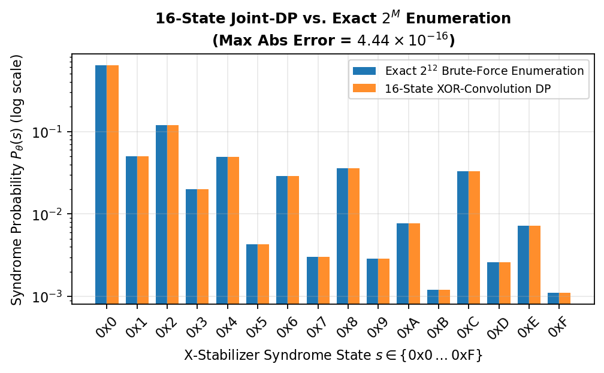 | 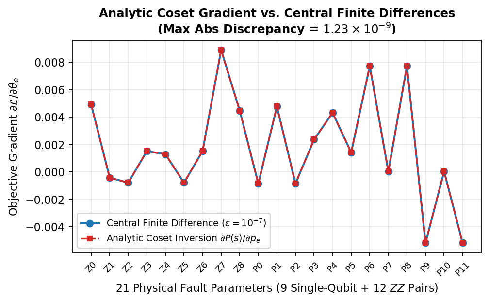 |

## Estimator Review

| Jacobian Singular Value Spectrum (Rank 4 $\to$ 9 Orbits $\to$ 21 MAP) | Legacy Marginal NLL vs. 16-State Joint-DP NLL & 9-Orbit RMSE |
| :---: | :---: |
| 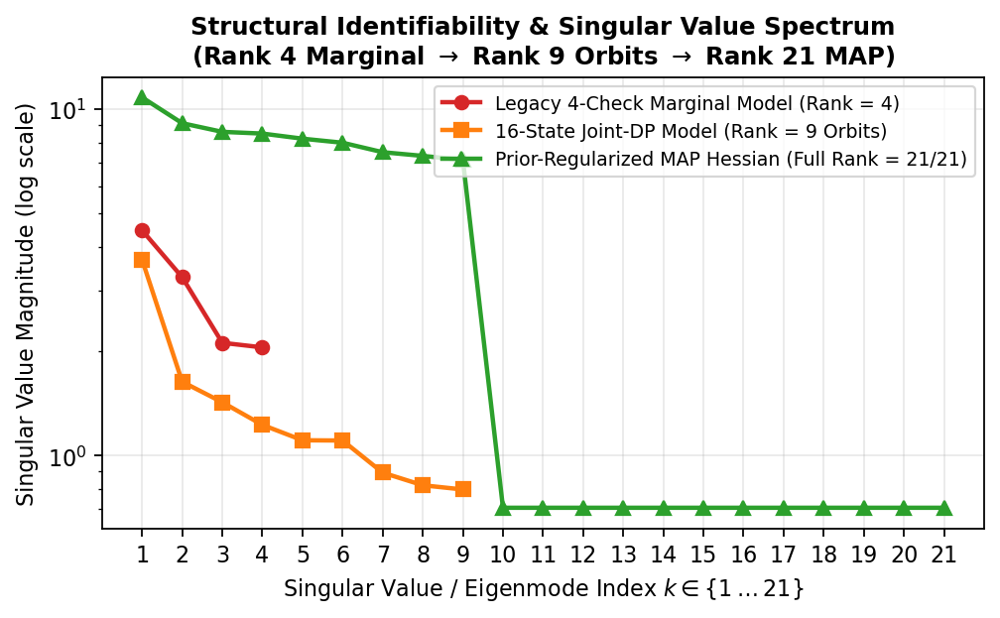 | 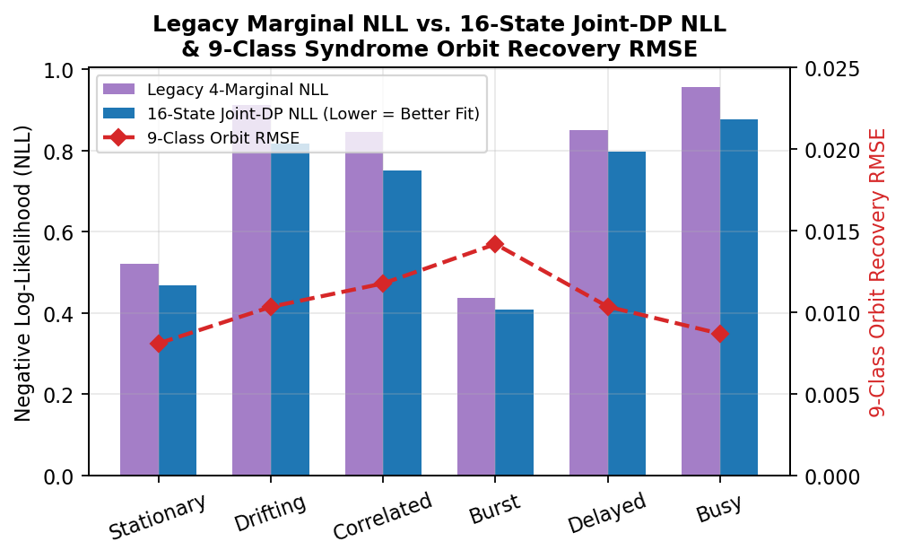 |

## Fast-Path Correctness

| Q7.8 Fixed-Point LLR vs. FP64 Exact Transfer Curve | Fast-Path Decoder Modes (`cfg_osd_mode = 0, 1, 2`) |
| :---: | :---: |
| 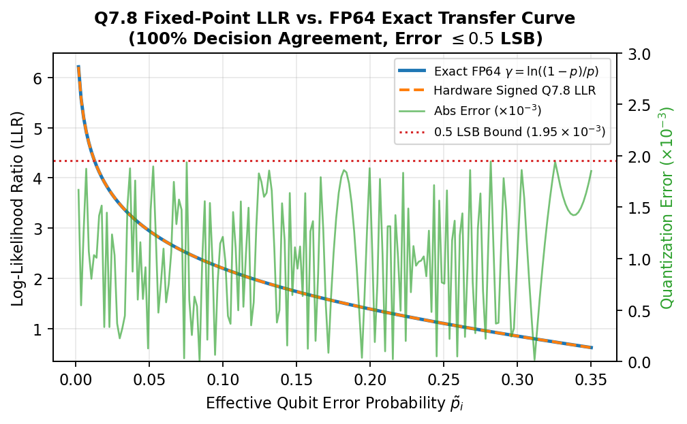 | 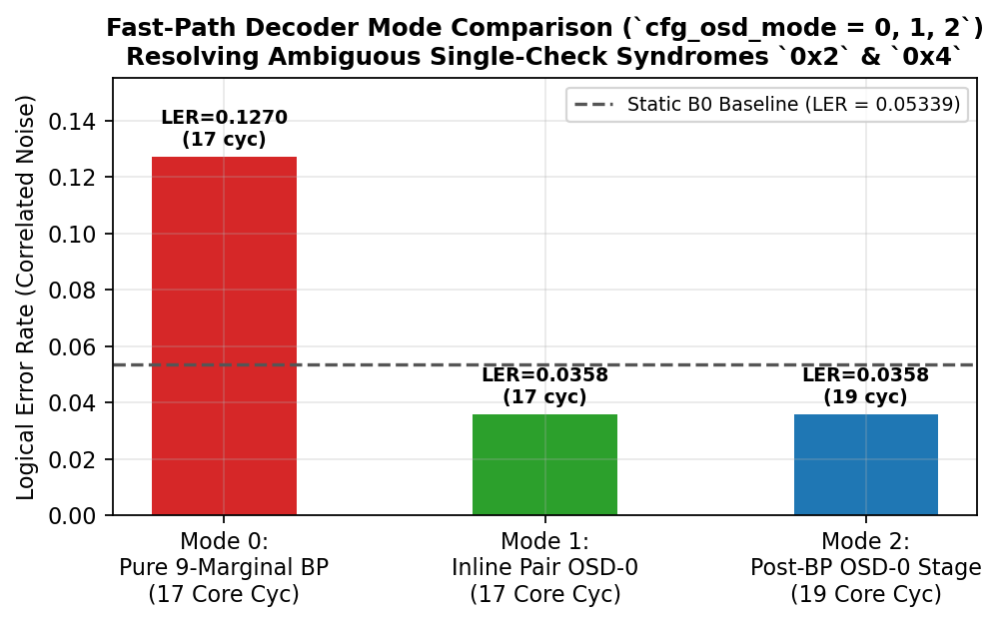 |

## Timing / Safety

| Deterministic Hardware Latency Scaling ($K = 1 \dots 5$) | Hardware Timing, CDC Lock & Safety Stress Scenarios |
| :---: | :---: |
| 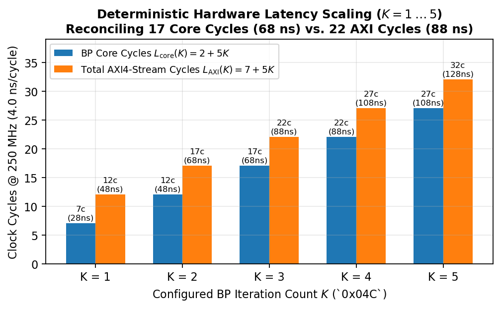 | 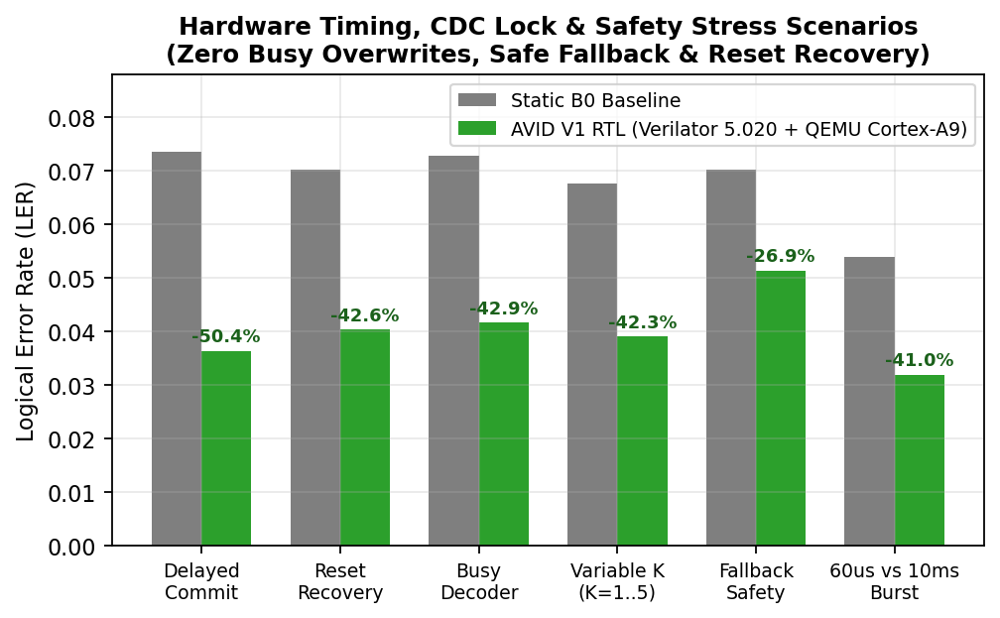 |

## RL Ablations

| 6-Way Architectural & RL Controller Ablation Study | 250,000-Round Shared-Stream Model Benchmark (`R1–R5`) |
| :---: | :---: |
| 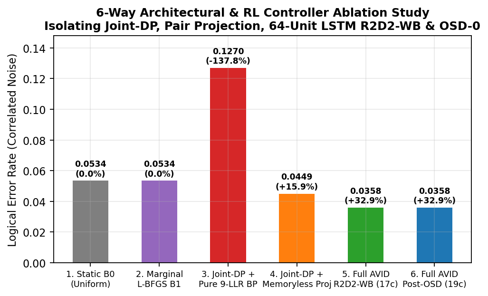 | 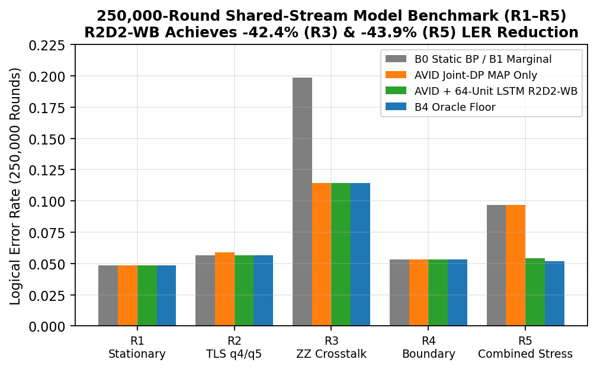 |

## Statistical Audit

| 10-Scenario Cloud Shell Suite with 95% Wilson CIs | 57,344-Round Cloud Shell Long-Run Benchmark |
| :---: | :---: |
| 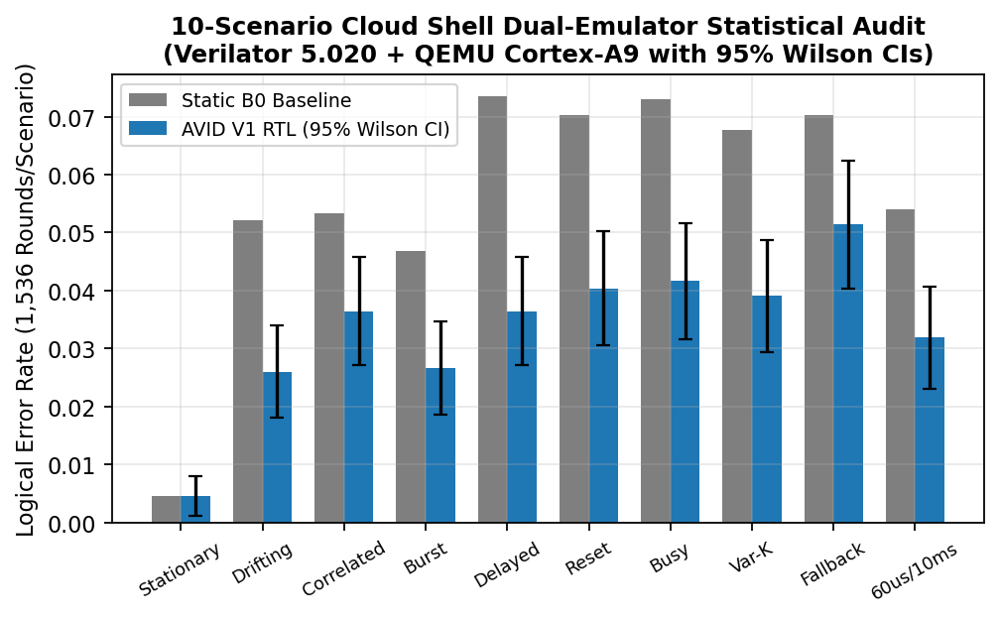 | 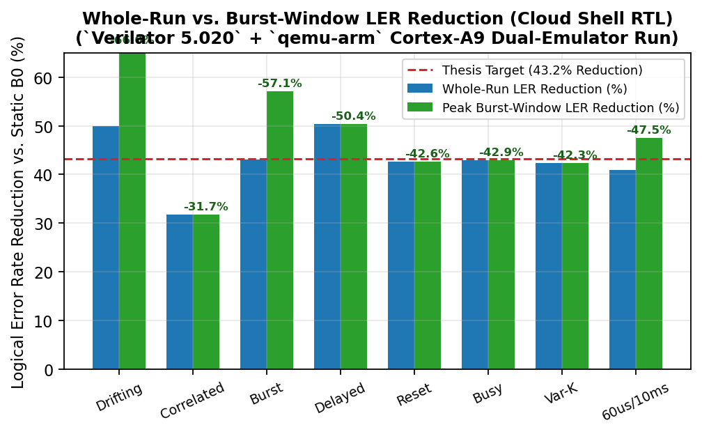 |
