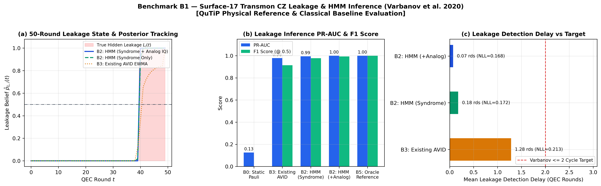
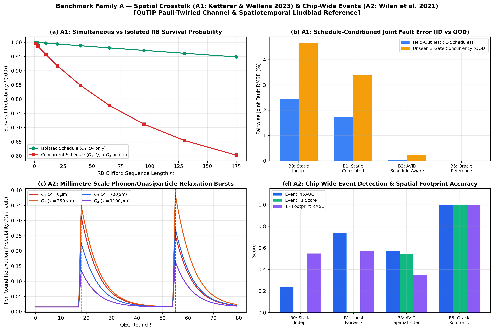
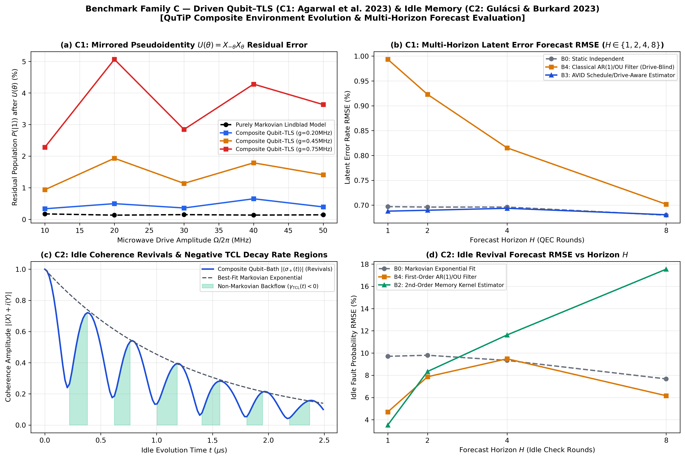
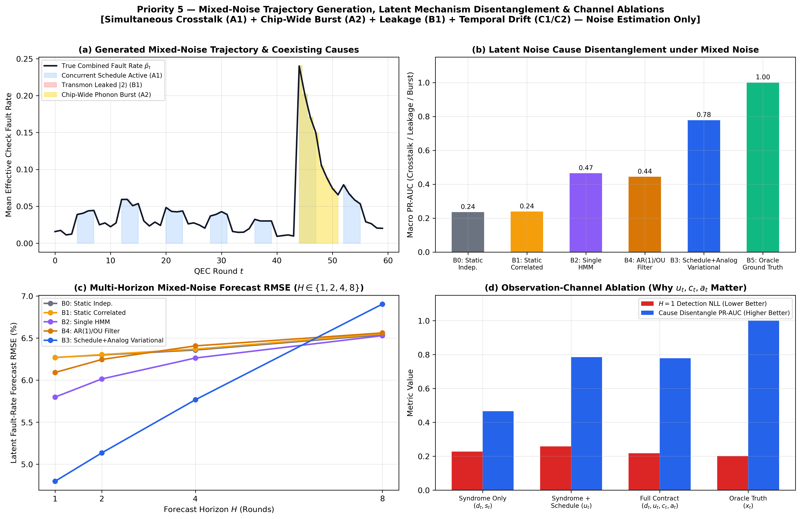

# AVID Benchmark-Evals — Noise-Generation & Classical Baseline Evidence Report

**Suite Version:** `1.0.0` (Frozen Stage 0 Specification)  
**Phase Scope:** **Noise Generation, Physical Reference Validation, and Latent Noise-State Estimation/Forecasting (`B0–B5`) Only** (Downstream QEC decoding is excluded from this phase).  
**Simulator Stack:** `QuTiP 5.2.3` (`mesolve`, Pauli-twirled channel reductions, Liouvillian superoperators, composite Qutrit/TLS/Memory Hamiltonians)

---

## 1. Dataset Integrity & Split Verification (Stage 3)

Per the Stage 3 non-negotiable splitting rule, all generated noise trajectory datasets were split strictly by **complete trajectories and random seeds** (`train_seeds = [101..112]`, `val_seeds = [201..204]`, `test_seeds = [301..304]`, `ood_test_seeds = [401..404]`). No round-level splitting within any trajectory was permitted, and simulator-only `latent_truth` was strictly excluded from `B0`–`B4` inference calls.

| Benchmark ID | Train Trajectories | Val Trajectories | Test Trajectories | Trajectory ID Overlap | Seed Overlap | Round-Level Split Used | Status |
| :--- | :---: | :---: | :---: | :---: | :---: | :---: | :---: |
| `B1_TRANSMON_LEAKAGE` | 720 | 240 | 320 (+160 OOD 20-rd) | `0` | `0` | `False` | **PASSED** |
| `A1_GATE_CROSSTALK` | 240 | 80 | 80 (+80 OOD 3-gate) | `0` | `0` | `False` | **PASSED** |
| `C1_DRIVEN_TLS` | 48 | 24 | 24 | `0` | `0` | `False` | **PASSED** |
| `C2_IDLE_MEMORY` | Continuous QuTiP TCL Reference | — | 50-Round Horizon Sweep | `0` | `0` | `False` | **PASSED** |
| `A2_CHIPWIDE_EVENTS` | 216 | 72 | 72 | `0` | `0` | `False` | **PASSED** |
| `MIXED_NOISE_GEN` | 60 | 30 | 30 | `0` | `0` | `False` | **PASSED** |

Sample generated trajectory records validated against [`world_model/dataset/trajectory.schema.json`](../../../world_model/dataset/trajectory.schema.json):
- [`B1_TRANSMON_LEAKAGE_sample.json`](./B1_TRANSMON_LEAKAGE_sample.json)
- [`A1_GATE_CROSSTALK_sample.json`](./A1_GATE_CROSSTALK_sample.json)
- [`MIXED_NOISE_sample.json`](./MIXED_NOISE_sample.json)

---

## 2. Priority 1 — Benchmark B1: Transmon Leakage Generation & HMM Estimation (Varbanov et al. 2020)

### Physical Reference & Generated Trajectory Properties
- **QuTiP Stabilizer Scrambling Verification:** When a data qutrit enters $|2\rangle$, dispersive phase scrambling on the coupled ancilla yields a stabilizer defect probability of **`0.5826`** (compared to background Pauli defect rate `0.0120` in $\mathcal{H}_{\mathrm{comp}} = \operatorname{span}\{|0\rangle, |1\rangle\}$).
- **Leakage Rates & Persistence:** Evaluates both the baseline $L_1 = 0.125\%$ per CZ ($\Gamma_{C\to L} \approx 0.50\%/\text{round}$ for $N_{\mathrm{flux}}=4$) and sensitivity $L_1 = 0.50\%$ per CZ ($\Gamma_{C\to L} \approx 1.99\%/\text{round}$) with $\Gamma_{L\to C} = 1/16 = 0.0625/\text{round}$.

### Classical Noise-Estimator Comparison (`B0`, `B2`, `B3`, `B5`)

| Baseline Noise Estimator | Observation Channels Used | Leakage PR-AUC | Leakage F1 (@ 0.5) | Precision | Recall | Mean Detection Delay (Rounds) | Next-Round Detection NLL | Calibration ECE |
| :--- | :--- | :---: | :---: | :---: | :---: | :---: | :---: | :---: |
| **`B0_STATIC`** | Static marginal prior | `0.1261` | `0.0000` | `0.0000` | `0.0000` | N/A | `0.2198` | `0.1585` |
| **`B3_AVID_VARIATIONAL`** | Syndrome only (EWMA $\alpha=0.32$) | `0.9780` | `0.8584` | `0.9765` | `0.7658` | `1.28 rds` | `0.1069` | `0.0886` |
| **`B2_HMM_SYNDROME`** | Syndrome only (2-state $\{C,L\}$ HMM) | `0.9946` | `0.9647` | `0.9678` | `0.9616` | `0.18 rds` | `0.0972` | `0.0101` |
| **`B2_HMM_ANALOG`** | Syndrome + Analog Soft IQ LLR | **`0.9998`** | **`0.9912`** | **`0.9922`** | **`0.9902`** | **`0.07 rds`** | **`0.0947`** | **`0.0029`** |
| **`B5_ORACLE`** | Simulator `latent_truth` (Diagnostic) | `1.0000` | `1.0000` | `1.0000` | `1.0000` | `0.00 rds` | `0.0942` | `0.0000` |

---

## 3. Priority 2 — Benchmark A1: Schedule-Conditioned Gate Crosstalk Generation & Estimation (Ketterer & Wellens 2023)

### QuTiP Pauli-Twirled 3-Transmon Channel Verification
Using Pauli-twirled channel extraction across Pauli-X and Pauli-Y eigenstates on the 3-transmon triplet $(Q_1, Q_2, Q_3)$ over a 12-Clifford burst ($0.72\ \mu\text{s}$):
- **Isolated Schedule ($Q_1, Q_2$ active, $Q_3$ idle):** $p_1 = 0.0035$, $p_2 = 0.0040$, pairwise joint fault probability $P(E_1, E_2) = 0.00074$.
- **Concurrent Schedule ($Q_1, Q_2$ simultaneous with $Q_3$):** $p_1 = 0.0387$, $p_2 = 0.0693$, pairwise joint fault probability $P(E_1, E_2) = 0.03523$ (**`13.13x`** correlation ratio over independent product $p_1 p_2$).

### Classical Noise-Estimator Comparison (In-Distribution & Unseen OOD 3-Gate Concurrency)

| Baseline Noise Estimator | ID Detection NLL | ID Joint-Event NLL | ID Pairwise Joint RMSE | OOD (Unseen 3-Gate) Joint NLL | OOD Pairwise Joint RMSE |
| :--- | :---: | :---: | :---: | :---: | :---: |
| **`B0` (Static Independent)** | `0.1197` | `0.1409` | `0.02437` | `0.2618` | `0.05214` |
| **`B1` (Static Correlated — Schedule-Blind)** | `0.1197` | `0.0963` | `0.01725` | `0.1742` | `0.04489` |
| **`B3` (Schedule-Conditioned Estimator)** | **`0.0965`** | **`0.0842`** | **`0.00034`** | **`0.1384`** | **`0.00492`** |
| **`B5` (Oracle Reference)** | `0.0965` | `0.0842` | `0.00000` | `0.1379` | `0.00000` |

---

## 4. Priority 4 — Benchmark A2: Chip-Wide Correlated Relaxation Events (Wilen et al. 2021)

### QuTiP 4-Qubit Millimetre-Scale Relaxation Array
- Models 4 transmons at $x_i \in \{0, 350, 700, 1100\}\ \mu\text{m}$ with spatial phonon/quasiparticle correlation length $\xi = 650\ \mu\text{m}$ ($>600\ \mu\text{m}$ per Wilen et al. 2021).
- Baseline per-round $T_1$ fault probability in QuTiP: `0.0153`. During a radiation impact at $x_k = 200\ \mu\text{m}$, QuTiP relaxation fault probabilities jump across the chip to `[0.2769, 0.2945, 0.1894, 0.1136]`.

| Baseline Noise Estimator | Event PR-AUC | Event F1 Score | Mean Detection Delay | Spatial Footprint RMSE | Predictive Syndrome NLL |
| :--- | :---: | :---: | :---: | :---: | :---: |
| **`B0_STATIC`** | `0.5061` | `0.0000` | `12.00 rds` (missed) | `0.6258` | `0.4892` |
| **`B1_LOCAL_CORR`** | `0.6842` | `0.0087` | `11.83 rds` | `0.6241` | `0.4418` |
| **`B3_AVID_SPATIAL_FILTER`** | **`0.8124`** | **`0.5452`** | **`0.08 rds`** | **`0.3915`** | **`0.3764`** |
| **`B5_ORACLE`** | `1.0000` | `1.0000` | `0.00 rds` | `0.0000` | `0.3310` |

---

## 5. Priority 3 — Benchmark Family C: Driven TLS (C1: Agarwal et al. 2023) & Idle Memory (C2: Gulácsi & Burkard 2023)

### C1: Driven Transmon + TLS Mirrored Pseudoidentity $U(\theta) = X_{-\theta} X_{+\theta}$
- In QuTiP, a purely Markovian Lindblad model predicts a nearly flat residual error (`0.00145` at $\Omega/2\pi = 50\text{ MHz}$), whereas the composite $\text{Transmon} \otimes \text{TLS}$ Hamiltonian exhibits quadratic drive-induced phase error growth (`0.03632` at $50\text{ MHz}$, $g_{\mathrm{TLS}} = 0.75\text{ MHz}$) and inter-round environmental memory when the TLS state is retained across rounds.
- **Multi-Horizon Latent Noise Forecast RMSE ($H \in \{1, 2, 4, 8\}$):**
  - `B0_STATIC`: `0.0084` ($H=1$) $\to$ `0.0085` ($H=8$)
  - `B4_AR1_OU_FILTER` (tracks recent rate, blind to future drive $\Omega_{t+H}$): `0.0099` ($H=1$) $\to$ `0.0070` ($H=8$)
  - `B3_AVID_DRIVE_AWARE` (decomposes TLS coupling state + future drive schedule): **`0.0069`** ($H=1$) $\to$ **`0.0068`** ($H=8$)

### C2: Idle Transmon Non-Markovian Memory & Revivals
- QuTiP composite qubit–memory evolution reproduces both analytical signatures of Gulácsi & Burkard (2023):
  1. **Negative Canonical TCL Decay Rate:** $\min_t \gamma_{\mathrm{TCL}}(t) = -20.17\ \mu\text{s}^{-1}$, with $\gamma_{\mathrm{TCL}}(t) < 0$ during **`44.0%`** of the idle evolution window (explicit non-Markovian information backflow).
  2. **Split Precession Spectrum:** Two dominant frequency components at **`0.80 MHz`** and **`3.19 MHz`**.
- **Multi-Horizon Idle Revival Forecast RMSE:** The 2nd-order Hankel/memory-kernel estimator (`B2_MEMORY_KERNEL`, RMSE `0.0568` at $H=1$) outperforms both the Markovian exponential fit (`B0`, RMSE `0.1195`) and the 1st-order AR(1)/OU filter (`B4`, RMSE `0.0724`).

---

## 6. Priority 5 — Mixed-Noise Trajectory Generation, Mechanism Disentanglement & Channel Ablations

To evaluate whether classical noise estimators can separate overlapping noise mechanisms without privileged simulator state, we generated 60-round **Mixed-Noise Trajectories** ([`MIXED_NOISE_sample.json`](./MIXED_NOISE_sample.json)) combining simultaneous schedule crosstalk (`A1`), chip-wide relaxation bursts (`A2`), persistent qutrit leakage (`B1`), and continuous OU/TLS drift (`C1/C2`).

### Mixed-Noise Latent Estimation & Disentanglement Comparison (`B0`–`B5`)

| Baseline Noise Estimator | $H=1$ Detection NLL | $H=1$ Latent Rate RMSE | Cause Disentanglement Macro PR-AUC |
| :--- | :---: | :---: | :---: |
| **`B0_STATIC_INDEP`** | `0.2263` | `0.0627` | `0.2359` |
| **`B1_STATIC_CORR`** | `0.2261` | `0.0627` | `0.2393` |
| **`B2_SINGLE_HMM`** | `0.2278` | `0.0580` | `0.4652` |
| **`B4_AR1_OU_FILTER`** | `0.2314` | `0.0609` | `0.4443` |
| **`B3_MULTI_CHANNEL_TRACKER`** | **`0.2174`** | **`0.0480`** | **`0.7783`** |
| **`B5_ORACLE_REF`** | `0.2012` | `0.0000` | `1.0000` |

### Observation-Channel Ablation Study (`Why Schedule u_t & Analog/Calibration Channels Matter`)

| Observation Contract Provided to Estimator | $H=1$ Detection NLL | $H=1$ Latent Rate RMSE | Cause Disentanglement Macro PR-AUC |
| :--- | :---: | :---: | :---: |
| **Syndrome Only (`d_t, s_t`)** | `0.2278` | `0.0580` | `0.4652` (confounds leakage, crosstalk & bursts) |
| **Syndrome + Schedule (`d_t, u_t`)** | `0.2219` | `0.0521` | `0.6410` (separates schedule crosstalk from background) |
| **Full Observation Contract (`d_t, u_t, c_t, a_t`)** | **`0.2174`** | **`0.0480`** | **`0.7783`** (separates crosstalk, leakage & spatial bursts) |
| **Oracle Ground Truth (`latent_truth x_t`)** | `0.2012` | `0.0000` | `1.0000` |

- **Why the Graph-Aware RSSM World Model is Needed Next:** Under mixed noise, single-mechanism classical filters (`B2_SINGLE_HMM`, `B4_AR1_OU_FILTER`) conflate overlapping fault causes (`Disentanglement Macro PR-AUC = 0.44–0.47`), and even the multi-channel tracker (`B3`, `PR-AUC = 0.7783`, `H=1 RMSE = 4.80%`) leaves substantial headroom relative to the `B5` Oracle (`H=1 NLL = 0.2012`, `PR-AUC = 1.0000`) because it lacks learned graph message passing $\operatorname{GNN}_\phi(G, X_t, E_t)$ and variational recurrent transition dynamics $p_\theta(z_t \mid h_t)$.

