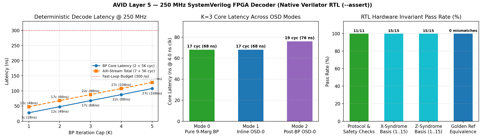

# AVID Layer 5 — 250 MHz SystemVerilog FPGA RTL Decoder

## 1. Layer Work Description

Branch `layer5-fpga-rtl-decoder` isolates **Layer 5** of the Adaptive Variational Inference Decoder (AVID): the synthesizable 250 MHz ($4.0\text{ ns}$ clock) SystemVerilog FPGA fast-loop belief-propagation (BP) and ordered-statistics (OSD-0) rotated $d=3$ CSS surface-code decoder (`aa_qec_top`).

Core implemented, remediated (`DEF-L5-01`..`08`), and verified hardware modules in this layer:
- **Pipelined Q7.8 Min-Sum BP & OSD-0 Core (`firmware/rtl/decoder/`)**: `bp_engine.sv` and multiplier-free `check_node_minsum.sv` execute deterministic $d=3$ CSS decoding with exact core latency $L_{\text{core}}(K) = 2 + 5K$ cycles ($17\text{ cycles} = 68.0\text{ ns}$ at $K=3$, well inside the $300.0\text{ ns}$ fast-loop budget) and three runtime `cfg_osd_mode` paths (`Mode 0` pure 9-marginal BP in $17$ cycles, `Mode 1` inline OSD-0 in $17$ cycles, `Mode 2` post-BP OSD-0 in $19$ cycles).
- **Non-Blocking Ingress Tap & Elastic AXI4-Stream Channels (`firmware/rtl/top/aa_qec_top.sv`, `firmware/rtl/ingress/`, `firmware/rtl/decoder/`)**: `axis_ingress_tap.sv` mirrors accepted syndrome beats to slow-loop telemetry while isolating `dma_tap_stall_in` drops (`dma_tap_drop_count_mon`) with zero fast-path stall; `axis_syndrome_rx.sv` (16-entry FIFO) and `axis_correction_tx.sv` stream `(s_x[3:0], s_z[3:0])` to `(corr_x[8:0], corr_z[8:0])` in $L_{\text{axis}}(K) = 7 + 5K$ cycles ($22\text{ cycles} = 88.0\text{ ns}$ at $K=3$) with `aresetn` ready gating, lossless `tready` backpressure, and 1-cycle `epoch_irq` assertion strictly on `tlast=1`.
- **Triple-Buffered AXI4-Lite Weight Registers, Bound Formal SVA & XDC (`firmware/rtl/config/weight_map_reg.sv`, `firmware/formal/assertions/sva_weight_commit_assertions.sv`, `firmware/constraints/aa_qec.xdc`)**: Shadow/snapshot/active Q7.8 X and Z weight banks (`0x000..0x144`), split `AW`/`W` phases, halfword `WSTRB` torn-write SLVERR protection, `bp_ready_in`-gated atomic bank swap, busy-lock SLVERR (`swap_pending=1`), live `bind` SVA verification under `Verilator 5.048 --assert`, and active `4.000 ns` clock constraints. *(Scope note: cycle-accurate Verilator RTL simulation proves synchronous FSM timing, AXI handshakes, Q7.8/OSD-0 math, and SVA invariants; physical 250 MHz WNS/TNS sign-off requires Vivado synthesis and post-route STA.)*

## 2. Run Script to Validate & Generate Results + Plots

Compile native SystemVerilog `aa_qec_top` + bound formal SVA with `Verilator 5.048 --assert --trace`, execute the standalone M1 RTL testbench, `pytest` IP/OP check, all 5 canonical test sets (`200` `L5-*` IDs), evaluate gates `G1`–`G8`, and generate plots from the repository root:

```bash
python3 -m pip install --user -q numpy pyyaml pytest matplotlib
bash scripts/run_layer5.sh
```

To regenerate `results/layer5_summary.json` and `results/plots/layer5_validation_summary.png` directly from the committed clean audit run (`remediated_full_layer5_v1`):

```bash
PYTHONPATH=. python3 scripts/plot_layer5_results.py
```

Generated outputs:
- Execution log & report: `logs/layer5_validation.log`, `validation/layer5/reports/layer5_validation_report.md`
- Gate manifest & summary: `validation/layer5/runs/remediated_full_layer5_v1/acceptance/gate_evaluation.json`, `results/layer5_summary.json`
- Standalone RTL CSV/JSON & plot: `results/rtl_cycle_matrix.csv`, `results/m1_standalone.json`, `results/plots/layer5_validation_summary.png`



## 3. Validation Results

| Validation Set / Acceptance Gate | Scope Verified | Cases | Passed | RTL Cycles / Key Metric | Status |
| :--- | :--- | ---: | ---: | :--- | :--- |
| **Set 1** — Input, AXI4-Lite & AXI-S Ingress | `s_axis` handshakes/packing, `0x000..0x144` map, split `AW`/`W`, `WSTRB`, SLVERR, Q7.8 bounds | 44 | 44 | `2,868` RTL cycles (`Verilator 5.048 --assert`) | **PASS** |
| **Set 2** — Output & Deterministic Cycle Law | $L_{\text{core}}=2+5K$, $L_{\text{axis}}=7+5K$, $\le 300\text{ ns}$ budget, OSD `{17,17,19}`, `epoch_irq`, replay | 38 | 38 | `35,989` RTL cycles (`68.0 ns` core / `88.0 ns` AXI @ $K=3$) | **PASS** |
| **Set 3** — Ingress Tap & Atomic Weight Flow | `axis_ingress_tap` zero-stall drop isolation, multi-epoch swap, mid-decode `COMMIT` deferral & SLVERR lock | 36 | 36 | `17,000` RTL cycles (`0` fast-path stall cycles) | **PASS** |
| **Set 4** — Backpressure, Reset & 10k Stress | Mid-decode `aresetn` across all BP states, 16-deep FIFO full/drain, 10,000-syndrome stress, VCD/SHA-256 | 40 | 40 | `384,457` RTL cycles (`10,000` stream + `1,576` M1 TB) | **PASS** |
| **Set 5** — Q7.8 Min-Sum, OSD-0, SVA & XDC | 3,840-state golden Q7.8 sweep, `wx != wz` tie-break, GF(2) parity, bound SVA firing, `4.000 ns` XDC | 42 | 42 | `175,631` RTL cycles (`0 / 3,840` golden mismatches) | **PASS** |
| **Gates `G1`–`G4`** | AXI Protocol (`57`), Cycle Law (`57`), Tap Isolation (`22`), Atomic Weight-Bank Safety (`30`) | 166 | 166 | Core `{7,12,17,22,27}`; AXI `{12,17,22,27,32}` cyc | **PASS** |
| **Gates `G5`–`G8`** | Backpressure/Stress (`45`), Q7.8/OSD Math (`44`), SVA/XDC (`21`), Clean Provenance & STA (`18`) | 128 | 128 | Clean git tree (`Dirty=False`), `pytest` `1/1` PASS | **PASS** |
| **Layer 5 Total** | **Complete 5-Set Canonical Suite, Standalone M1 TB & All 8 Gates (`G1`–`G8`)** | **200 IDs** | **200 IDs** | **`617,521` native Verilator RTL cycles (`0` failures)** | **PASS** |
