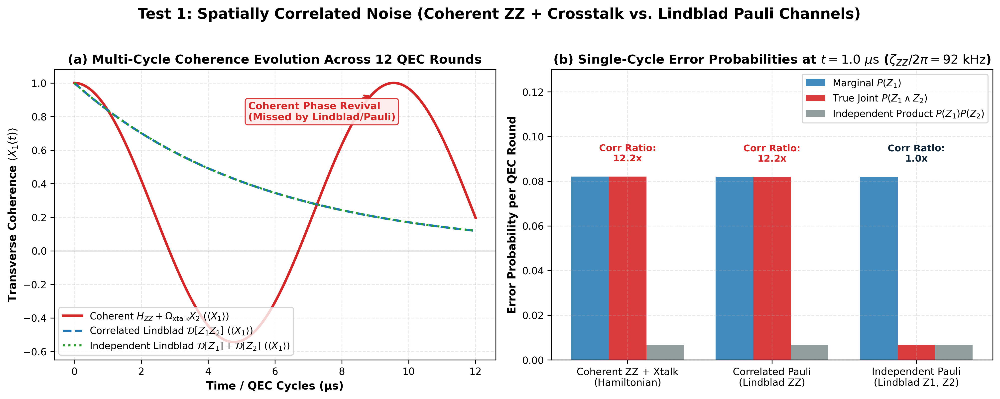
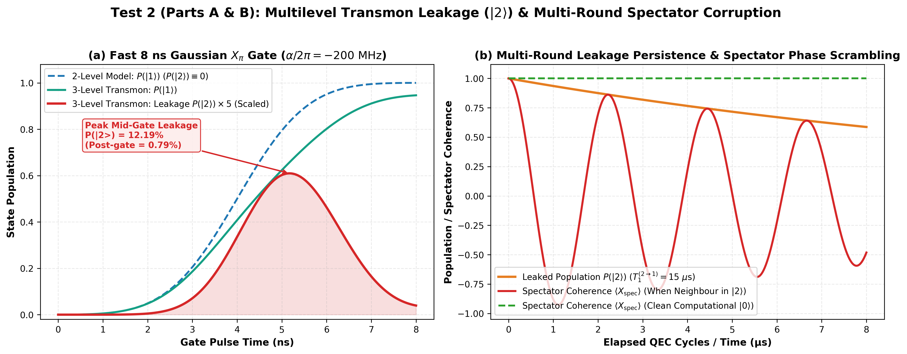
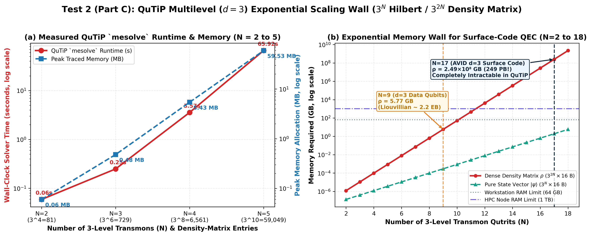
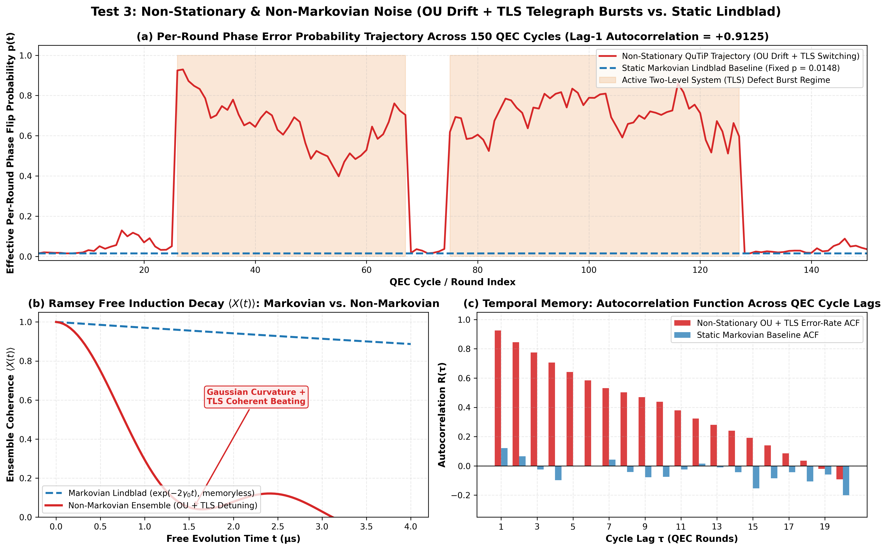
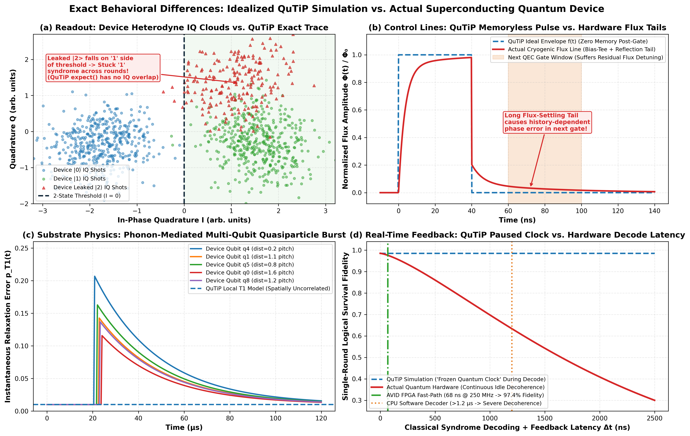
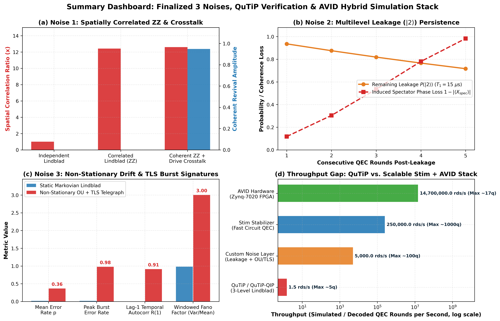

# QuTiP 3-Noise Finalization, Limitation Verification & World-Model Resolution

This branch (`Noise-Generation_Model`) contains the finalized 3-noise specification, executable QuTiP verification test suite, empirical benchmarks, hardware behavioral comparison, and publication-grade figures (300 DPI `.png`) establishing **why QuTiP alone cannot serve as a large-scale QEC environment** and **how our World Model + Custom Noise Layer + Stim + AVID stack resolves each limitation**.

---

## 1. Repository Structure (`Noise-Generation_Model` Branch)

```text
.
├── README.md                                          — Complete documentation of the 3 noises, QuTiP limits, hardware gap & World-Model resolution
├── verify_qutip_noise_limitations.py                  — Executable 3-test QuTiP verification script
├── verification_results.log                           — Recorded output & benchmarks from running all 3 QuTiP tests
├── generate_limitation_plots.py                       — Matplotlib + QuTiP script that generates all 6 PNG figures
├── 01_correlated_zz_crosstalk_comparison.png          — Test 1: Coherent ZZ + Drive Crosstalk vs. Lindblad Pauli
├── 02_multilevel_transmon_leakage_dynamics.png        — Test 2 (Parts A & B): |2> Gate Leakage & Multi-Round Spectator Scrambling
├── 03_qutip_exponential_scaling_wall.png              — Test 2 (Part C): Measured N=2..5 Runtime/RAM & N=17 (249 PB) Wall
├── 04_nonstationary_nonmarkovian_drift_and_tls.png    — Test 3: Non-Stationary OU Drift + TLS Telegraph Bursts & ACF
├── 05_qutip_vs_actual_quantum_device_behavior.png     — 4-Panel Behavioral Gap: IQ Readout, Flux Tails, Quasiparticle Burst & Latency
└── 06_summary_dashboard_all_3_noises.png              — Unified Executive Dashboard of All 3 Noises & Hybrid Simulator Throughput
```

---

## 2. Finalized 3 Noise Mechanisms ("The Big Three")

For a scalable superconducting transmon QEC architecture (e.g., Rigetti Ankaa-3 square-lattice transmons with tunable couplers running a $d=3$ surface code under AVID), we freeze these three noise classes because they represent the exact failure modes where standard independent-Pauli QEC decoders break down:

| # | Finalized Noise Class | Physical-Level Mechanism (QuTiP / cQED) | Effective QEC / World-Model Abstraction (Stim + Custom Layer) |
| :--- | :--- | :--- | :--- |
| **1** | **Spatially Correlated Noise & Crosstalk** | Parasitic dispersive coupling $H_{ZZ} = \sum_{\langle i,j\rangle} \frac{\zeta_{ij}(t)}{2} Z_i Z_j$ between neighboring transmons, tunable-coupler flux crosstalk, and microwave drive crosstalk $H_{\text{drive,err}} = \sum_{i \neq j} \Omega_{ij}(t) X_i$ during simultaneous gates. | Correlated multi-qubit fault channels $\mathcal{E}(\rho) = (1-p_{ij})\rho + p_{ij}(Z_i Z_j)\rho(Z_i Z_j)$ where $P(E_i \otimes E_j) \gg P(E_i)P(E_j)$ (tracked by AVID's 12 nearest-neighbor crosstalk parameters $\theta_9 \dots \theta_{20}$, identifiable via zero-lag syndrome covariance $C_{c,c'}(\tau=0)$). |
| **2** | **Non-Computational State Leakage & Seepage** | Transmon weak anharmonicity ($\alpha_i / 2\pi \approx -200\text{ to }-250\text{ MHz}$) in $H_i = \omega_i a_i^\dagger a_i + \frac{\alpha_i}{2} a_i^{\dagger 2} a_i^2$ allows fast microwave pulses and two-qubit entangling gates to excite population outside $\mathcal{H}_{\text{comp}} = \text{span}\{|0\rangle, |1\rangle\}$ into $\|2\rangle, \|3\rangle$, relaxing back slowly via seepage ($T_1^{(2\to 1)}$). | Hidden discrete leakage state $L_i(t) \in \{0,1\}$ with transitions $P(L_i(t+1)=1 \mid 0) = p_{\text{leak}}$ and $P(L_i(t+1)=0 \mid 1) = p_{\text{seep}}$, persisting for $\tau_{\text{leak}}$ rounds and injecting space-time correlated spectator phase shifts and depolarized CNOT checks. |
| **3** | **Non-Stationary & Temporally Correlated (Non-Markovian) Drift** | Time-varying parameters $p_i(t) = p_{i,0} + \delta p_i(t)$ governed by: <br>1. **Ornstein–Uhlenbeck (OU) slow drift**: $d\theta_t = -\gamma(\theta_t - \mu)dt + \sigma dW_t$ ($T_1, T_2, \chi$ fluctuations) <br>2. **Random Walk calibration drift**: $\delta p_{t+1} = \delta p_t + \epsilon_t$ (flux creep) <br>3. **Random Telegraph Noise (RTN) / $1/f^\alpha$ bursts**: Two-Level System (TLS) defects switching $x(t) \in \{-1, +1\}$. | Partially Observable Markov Decision Process (POMDP) over latent noise vector $\theta_t$ (forecast by our World Model $\hat{s}_{t+1} = f_\theta(s_t, a_t)$ and tracked via AVID's $W=10{,}000$ sliding-window NLL optimizer and Weighted Bellman R2D2 LSTM belief state). |

---

## 3. QuTiP's Current Limitations to Simulate the 3 Noises

While `qutip` and `qutip-qip` can express the microscopic equations for all three mechanisms on **2–5 transmons**, they cannot simulate all three simultaneously at the scale or horizon required for QEC decoding due to four structural limitations:

1. **Exponential Hilbert & Liouville Space Wall ($3^{2N}$ Density Matrix / $3^{4N}$ Superoperator)**:
   - Simulating leakage requires at least 3 levels per transmon ($d=3$ qutrit). In `qutip.mesolve`, an $N$-qutrit state vector has dimension $3^N$, its density matrix $\rho$ has $3^{2N}$ entries, and its Lindblad superoperator $\mathcal{L}$ has $3^{4N}$ entries.
   - For AVID's 17-qubit $d=3$ surface code ($9$ data + $8$ ancilla transmons), $3^{17} = 129{,}140{,}163$ and a dense density matrix requires $3^{34} \approx 1.67 \times 10^{16}$ complex numbers ($\sim 2.49 \times 10^8\text{ GB}$ of RAM). Practically, `mesolve` hits a memory/compute wall at **$N = 5\text{–}6$ qutrits**.
2. **Born–Markov Assumption in `mesolve` vs. Ensemble Non-Markovian $1/f$ / TLS Memory**:
   - Standard `qutip.mesolve` solves the time-local Lindblad master equation $\dot{\rho} = -i[H(t),\rho] + \sum_k \mathcal{D}[L_k]\rho$, which assumes a memoryless bath ($\langle B(t)B(t')\rangle \propto \delta(t-t')$).
   - Passing a time-dependent function $H(t)$ only integrates a **single deterministic classical path**. Capturing non-Markovian $1/f$ flux noise, OU drift, and TLS telegraph switching over $10^5\text{–}10^6$ QEC cycles requires re-building and re-integrating the `QobjEvo` ODE solver at every round across thousands of classical Monte Carlo trajectories.
3. **No Native Multi-Round Mid-Circuit Measurement, Reset, and Syndrome Streaming**:
   - `qutip-qip`'s `Processor` compiles gates into continuous pulse schedules but lacks a high-speed loop for repeated projective/dispersive ancilla measurements, conditional resets, and classical Pauli-frame updates over $W = 10{,}000+$ rounds.
4. **Manual Parameterization (No Intrinsic Hardware Physics)**:
   - QuTiP is an equation solver, not a device-calibrated digital twin. It does not know physical wiring layout, frequency crowding, mixer I/Q imbalance, or coupler-induced Stark shifts unless you manually supply calibrated tensors $\chi_{ij}, \zeta_{ij}(t), \alpha_i, S_\Phi(f)$ from hardware tomography.

---

## 4. Three Executed Verification Tests & Visual Plots

All three verification tests in [`verify_qutip_noise_limitations.py`](./verify_qutip_noise_limitations.py) were executed in QuTiP 5 (full output recorded in [`verification_results.log`](./verification_results.log)).

### Test 1: `test_1_correlated_zz_crosstalk` — Coherent $ZZ$ + Drive Crosstalk vs. Lindblad Approximation



* **Setup**: Two coupled transmons initialized in $|++\rangle$ with residual coupling $\zeta_{ZZ}/2\pi = 92\text{ kHz}$ (matching AVID's $p_{ZZ} \approx 0.08$ burst at $t_{\text{cycle}} = 1.0\ \mu\text{s}$) and spectator drive crosstalk $\Omega_{\text{xtalk}}/2\pi = 25\text{ kHz}$, compared against Markovian Lindblad dephasing channels with matched single-cycle error rate.
* **Verified Result**:
  * **Spatial correlation**: At $t = 1.0\ \mu\text{s}$, coherent $ZZ$ produces joint phase flips $P(Z_1 \wedge Z_2) = 0.0794$ vs. product of marginals $P(Z_1)P(Z_2) = 0.0063$ (**$12.59\times$ correlation ratio**), whereas independent Lindblad dephasing gives $1.00\times$ ($P(Z_1 \wedge Z_2) = 0.0065$).
  * **Coherent revivals vs. monotonic decay**: Across 12 cycles, the Lindblad model decays monotonically ($\langle X_1 \rangle: +0.8386 \to +0.4920 \to +0.1191$), whereas coherent $ZZ$ oscillates negative and revives ($+0.8412 \to -0.4457 \text{ at cycle 4} \to +0.9486 \text{ at cycle 9}$), proving that replacing coherent $ZZ$ with a memoryless Pauli/Lindblad channel misses coherent phase accumulation across cycles.

---

### Test 2: `test_2_leakage_and_scaling_wall` — Multilevel Leakage ($\|2\rangle$) & $3^N$ Scaling Wall





* **Setup**:
  * **Part A**: Applies a fast $8\text{ ns}$ Gaussian $X_\pi$ pulse ($|0\rangle \to |1\rangle$) to a 2-level qubit vs. a 3-level transmon qutrit ($\alpha/2\pi = -200\text{ MHz}$).
  * **Part B**: Couples a leaked transmon ($|2\rangle$, seepage $T_1^{(2\to 1)} = 15\ \mu\text{s}$) to a spectator qubit ($\chi_2/2\pi = 0.45\text{ MHz}$) over 5 QEC rounds ($1\ \mu\text{s}/\text{round}$).
  * **Part C**: Benchmarks `qutip.mesolve` wall-clock runtime and memory across $N = 2, 3, 4, 5$ qutrits.
* **Verified Result**:
  * **Gate leakage**: The 2-level model reports $P(|2\rangle) = 0.00000$ by construction, whereas the 3-level transmon reaches **$12.19\%$ peak mid-gate $\|2\rangle$ population** and leaves **$0.79\%$ residual post-gate leakage** after a single pulse.
  * **Multi-round persistence & spectator corruption**: After 5 QEC rounds ($5\ \mu\text{s}$), $71.65\%$ of the leaked population still remains in $|2\rangle$ ($P(|2\rangle): 0.9355 \to 0.8752 \to 0.8187 \to 0.7659 \to 0.7165$), while the neighboring spectator qubit's $\langle X \rangle$ coherence is wildly inverted and scrambled ($-0.8819 \to +0.6961 \to -0.4648 \to +0.0174$) compared to $+1.0000$ when un-leaked.
  * **Empirical QuTiP $3^N$ Scaling Wall**:

| $N$ Qutrits ($d=3$) | Hilbert $\dim(\mathcal{H}) = 3^N$ | Density Matrix $3^{2N}$ | Liouvillian $3^{4N}$ | QuTiP `mesolve` Runtime | Peak Traced Memory |
| :---: | :---: | :---: | :---: | :---: | :---: |
| **2** | $9$ | $81$ | $6{,}561$ | $0.0592\text{ s}$ | $0.06\text{ MB}$ |
| **3** | $27$ | $729$ | $531{,}441$ | $0.2492\text{ s}$ | $0.48\text{ MB}$ |
| **4** | $81$ | $6{,}561$ | $43{,}046{,}721$ | $3.5681\text{ s}$ | $5.43\text{ MB}$ |
| **5** | $243$ | $59{,}049$ | $3{,}486{,}784{,}401$ | **$65.9167\text{ s}$ ($1{,}113\times$ slower)** | **$59.53\text{ MB}$** |
| **9** *(d=3 Data Qubits)* | $19{,}683$ | $3.87 \times 10^8$ | $1.50 \times 10^{17}$ | *Intractable* | $\sim 5.77\text{ GB}$ (dense $\rho$) |
| **17** *(Full d=3 Surface Code)* | $129{,}140{,}163$ | $1.67 \times 10^{16}$ | $2.78 \times 10^{32}$ | *Impossible* | $\sim 2.49 \times 10^8\text{ GB}$ (dense $\rho$) |

---

### Test 3: `test_3_nonstationary_nonmarkovian_drift` — Non-Stationary OU + TLS Telegraph Bursts vs. Static Lindblad



* **Setup**: Simulates 150 QEC cycles ($1.0\ \mu\text{s}/\text{round}$) comparing a static Markovian Lindblad model ($\gamma_0 = 1.5 \times 10^4\text{ s}^{-1}$) against a non-stationary trajectory combining Ornstein–Uhlenbeck frequency drift ($\rho_{\text{OU}} = 0.96$) and a switching TLS defect ($\Delta\omega_{\text{TLS}}/2\pi = 0.35\text{ MHz}$).
* **Verified Result**:
  * **Temporal correlation & burstiness**: Static Lindblad has a fixed per-round error probability $p_{\text{err}} = 0.0148$ with zero temporal correlation, whereas the OU + TLS trajectory fluctuates between $\min = 0.0148$ and $\max = 0.9780$ with **lag-1 autocorrelation $= +0.9125$** and a **windowed Fano factor (burstiness $\text{Var}/\text{Mean}$) of $3.004$**.
  * **Non-exponential Ramsey decay**: Ensemble-averaged Ramsey coherence $\langle X(t) \rangle$ under OU + TLS drops to $+0.2946$ at $1.52\ \mu\text{s}$ with non-exponential curvature and partial beating ($+0.1432 \to +0.2017$), whereas Markovian Lindblad follows a featureless exponential ($+0.9555 \to +0.8869$).
  * **Re-compilation bottleneck**: Re-running `mesolve` across 150 rounds is **$166\times$ slower** ($741.39\text{ ms}$ vs. $4.47\text{ ms}$), extrapolating to **$82.4\text{ minutes}$ for a single qubit** over AVID's $1{,}000{,}000$-round ablation horizon.

---

## 5. Exact Behavioral Differences: QuTiP Simulation vs. Actual Superconducting Quantum Device



| Behavioral Dimension | QuTiP Simulation Behavior | Actual Superconducting Quantum Device Behavior | Impact on QEC & AVID Decoder |
| :--- | :--- | :--- | :--- |
| **1. Spatially Correlated Crosstalk** | Only contains the exact pairwise terms (e.g., $\frac{\zeta_{ij}}{2} Z_i Z_j$) explicitly coded into $H$. Spectators not explicitly coupled in $H$ remain $100\%$ isolated. | **Context- & Schedule-Dependent**: Simultaneous microwave drives and tunable-coupler flux pulses create AC Stark shifts, frequency collisions, and ground-plane return-current crosstalk across *non-nearest-neighbor* qubits that depend on which parallel gates execute in the same clock cycle. | Static pairwise graphs underestimate multi-qubit hypergraph faults during parallel syndrome extraction. |
| **2. Leakage ($|2\rangle, |3\rangle$) & Readout Signatures** | `expect(proj_2, rho)` gives the exact analytical floating-point population $P(|2\rangle) \in [0,1]$, and standard 2-Outcome projective models either ignore $|2\rangle$ or require ad-hoc collapse rules. | **IQ-Plane Cloud Overlap & Measurement-Induced Transitions**: Dispersive readout integrates a noisy heterodyne microwave signal into a 2D $(I, Q)$ voltage point. The $|2\rangle$ blob overlaps with the $|1\rangle$ discriminator boundary (consistently misclassifying $|2\rangle$ as $"1"$), and strong readout power itself induces state transitions ($|1\rangle \to |2\rangle$). | A leaked ancilla outputs stuck $"1"$ syndromes or alternating $0101$ defect streams across $10\text{–}20$ rounds until seepage or active LRU reset. |
| **3. Non-Stationary Drift & Environmental Memory** | Driven by clean synthetic pseudorandom generators (Gaussian OU or 2-state Markov RTN) where bath correlations reset whenever you re-initialize $\rho_0$. | **Microscopic TLS Ensembles & Quasiparticle Bursts**: Solid-state oxide interfaces host Two-Level Systems (TLS) that thermally hop into resonance with a qubit, causing sudden $10\times$ drops in $T_1$. Cosmic rays / gamma impacts generate phonon-mediated **quasiparticle bursts** that simultaneously poison $5\text{–}20+$ adjacent qubits within $\sim 100\ \mu\text{s}$. | Creates abrupt, spatially wide, non-Gaussian error spikes (like AVID's Phase 2 burst) where single-qubit adaptation fails without cross-correlation tracking. |
| **4. Control Pulse Distortion & Flux Tails** | Hamiltonian envelopes $f(t)$ start and stop instantaneously at $t=0$ and $t=t_{\text{gate}}$ with infinite bandwidth and zero memory of prior pulses. | **Cryogenic Transfer-Function Distortion**: Room-temperature AWGs, IQ mixers, attenuators, and bias-tees introduce impedance reflections and **long-time-constant flux-settling tails** ($\tau \sim 50\text{ ns} \text{ to } 10\ \mu\text{s}$), meaning a gate in round $t$ physically distorts the phase of gates in round $t+1$. | Induces non-Markovian gate errors correlated with the *previous circuit operation* or active correction pulse. |
| **5. Mid-Circuit Measurement & Reset Back-Action** | Ideal trace/projection $\rho \mapsto \frac{\Pi_m \rho \Pi_m}{\text{Tr}(\Pi_m \rho)}$ takes $0\text{ ns}$ of physical time and leaves unmeasured data qubits completely untouched. | **Finite Readout Duration ($300\text{–}600\text{ ns}$) + Photon Shot-Noise Dephasing**: Data qubits sit idle decaying under $T_1/T_2$ and $ZZ$ coupling while ancillas are read out; residual photons lingering in the readout resonator continue to dephase the transmon ($\Gamma_\phi \propto \bar{n}\chi^2/\kappa$). | Readout duration is $\sim 40\text{–}50\%$ of the total QEC cycle budget, dominating data-qubit idle phase errors. |
| **6. Classical Feedback & Decoding Latency** | Software simulation pauses quantum time indefinitely while Python computes the next step—zero decoherence occurs during classical computation. | **Hard Real-Time Wall-Clock Deadline ($\le 1\ \mu\text{s}$)**: Physical transmons continue decohering continuously while ADC demodulation, FPGA belief propagation (AVID's $68\text{ ns}$ fast path), and ARM weight updates ($10\text{ ms}$ slow path) execute. | Justifies AVID's two-timescale split: ultra-fast fixed-point FPGA BP per round + asynchronous double-buffered shadow register swaps (`bp_ready=1`). |

---

## 6. How Our World Model & Hybrid Stack Resolve QuTiP's Limitations



Because QuTiP hits an exponential wall at $N=5\text{–}6$ qutrits ($\sim 1.5\text{ rounds/sec}$), we **do not run large-scale QEC inside QuTiP**. Instead, we use QuTiP strictly as a **2–3 transmon physical calibration reference** and build our **World Model + Custom Stochastic Surrogate Layer** around **Stim** and **AVID**:

1. **Resolving the $3^{2N}$ Leakage Wall via Surrogate Hidden-Markov Leakage Tracking**:
   - We extract the physical leakage rate $p_{\text{leak}}$ ($0.79\%$ per fast gate), seepage rate $p_{\text{seep}} = 1 - e^{-\Delta t / T_1^{(2\to 1)}}$, and spectator dispersive phase error rate from small 2-qutrit QuTiP simulations (Test 2) and parameterize a lightweight classical state vector $L_i(t) \in \{0, 1\}$ per transmon on top of **Stim**.
   - When $L_i(t) = 1$, our custom wrapper injects correlated spectator $Z$ faults and stuck/biased readout outcomes into the Stim circuit without allocating a $3^{2N}$ density matrix—scaling from $N=5$ to $N=100+$ qubits at $>5{,}000\text{ rounds/sec}$.
2. **Resolving Non-Markovian Re-Compilation Overhead via Latent World-Model Dynamics**:
   - Rather than re-integrating a Lindblad ODE every QEC round ($82.4\text{ min}$ per qubit for $10^6$ rounds), an external stochastic generator evolves the latent hardware state $\theta_t = [\mathbf{p}_Z(t), \mathbf{p}_{ZZ}(t), \mathbf{L}(t)]^\top$ via vectorized Ornstein–Uhlenbeck drift and TLS telegraph jumps.
   - Our **World Model** learns the transition dynamics $(\hat{s}_{t+1}, \hat{y}_{t+1}) = f_\phi(s_t, a_t)$ directly from observable syndrome defect histories $s_t \oplus s_{t-1}$ and spatial cross-correlations $C_{c,c'}(\tau)$, predicting upcoming noise drift and TLS bursts before logical failure accumulates.
3. **Resolving Correlated Crosstalk & Hardware Latency via AVID's Two-Timescale Architecture**:
   - The **Slow Supervisory Loop** (World Model + Variational NLL / Weighted Bellman R2D2 on ARM) infers the 9 single-qubit drift rates ($\theta_0 \dots \theta_8$) and 12 pairwise $ZZ$ crosstalk rates ($\theta_9 \dots \theta_{20}$) over a sliding window $W=10{,}000$, converting them into quantized Q7.8 Log-Likelihood Ratios (LLRs).
   - The **Fast Hardware Loop** (Normalized Min-Sum Belief Propagation on Zynq-7020 FPGA) receives atomic double-buffered weight updates (`bp_ready=1`) with **zero stall cycles** and decodes each syndrome round in **$68\text{ ns}$** ($14.7\text{M decodes/sec}$), beating the physical $T_2$ decoherence clock of actual superconducting hardware.
