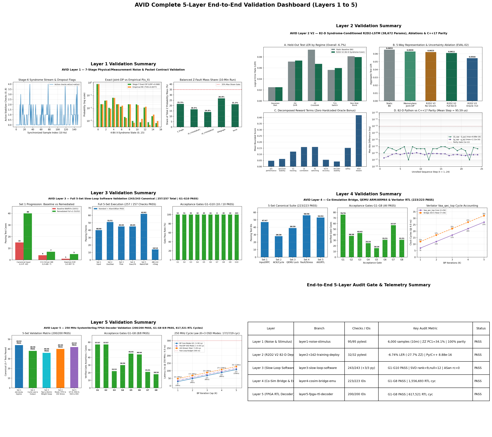
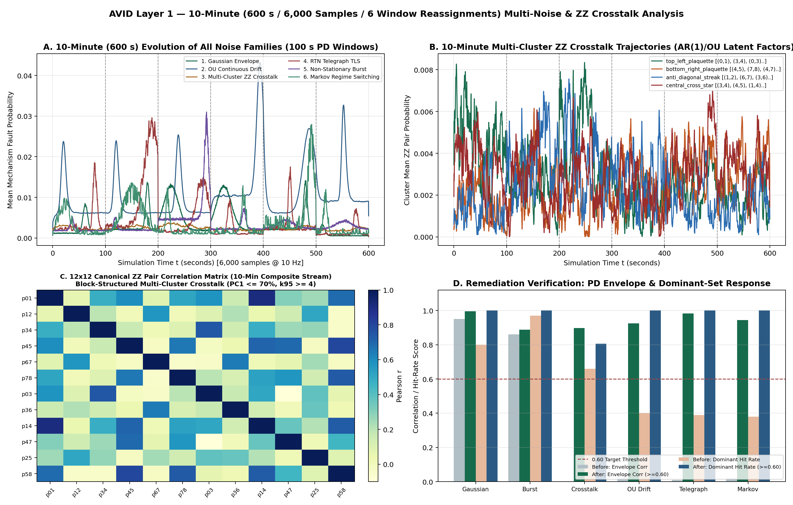
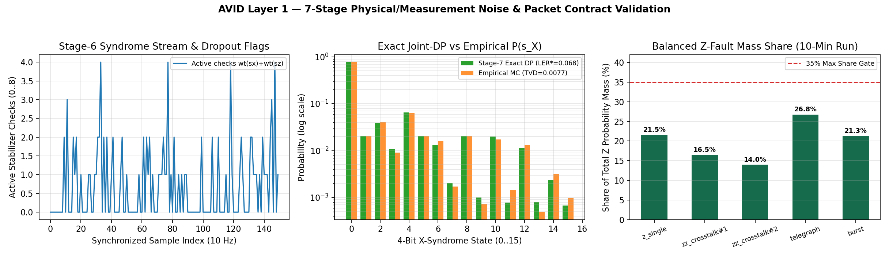
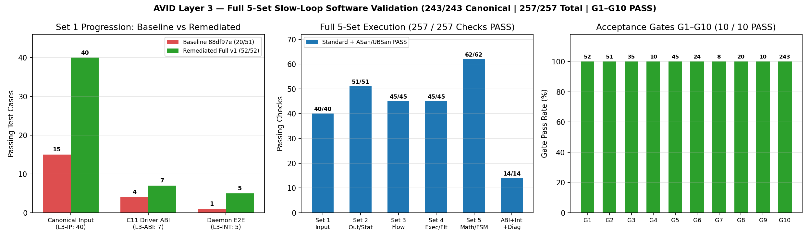
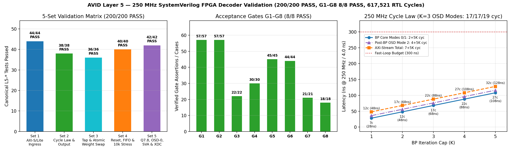

# AVID End-to-End 5-Layer Validation Results (Unpacked)

Complete unpacked outputs across **Layers 1 to 5** (`logs/`, `summaries/`, `reports/`, and `plots/`).

## 1. Master 5-Layer Validation Summary

| Layer | Branch | Checks / Canonical IDs | Key Audit Metric | Status |
| :--- | :--- | :--- | :--- | :--- |
| **Layer 1 (Noise & Stimulus)** | `layer1-noise-stimulus` | `95/95 pytest` | 6,000 samples (10m) | ZZ PC1=34.1% | 100% parity | **PASS** |
| **Layer 2 (R2D2 V2 82-D Deploy)** | `layer2-r2d2-training-deploy` | `32/32 pytest` | -6.74% LER (-27.7% ZZ) | Py/C++ 8.88e-16 | **PASS** |
| **Layer 3 (Slow-Loop Software)** | `layer3-slow-loop-software` | `243/243 (+3/3 py)` | G1-G10 PASS | SVD rank=9,null=12 | ASan rc=0 | **PASS** |
| **Layer 4 (Co-Sim Bridge & Emu)** | `layer4-cosim-bridge-emu` | `223/223 IDs` | G1-G8 PASS | 1,556,693 RTL cyc | **PASS** |
| **Layer 5 (FPGA RTL Decoder)** | `layer5-fpga-rtl-decoder` | `200/200 IDs` | G1-G8 PASS | 617,521 RTL cyc | **PASS** |

## 2. Per-Layer Diagnostic Plots

### Layer 1 — 10-Minute (600 s) 5-Noise & Multi-Cluster ZZ Correlations + Summary

### Layer 2 — V2 82-D Syndrome-Conditioned R2D2-LSTM, 5-Way Ablations & C++17 Parity

### Layer 3 — Slow-Loop Software, Bayesian Posterior & Adaptive Control

### Layer 4 — Co-Simulation Bridge, QEMU ARM32/ARM64 & Verilator Lockstep

### Layer 5 — 250 MHz SystemVerilog FPGA RTL BP + OSD-0 Decoder

