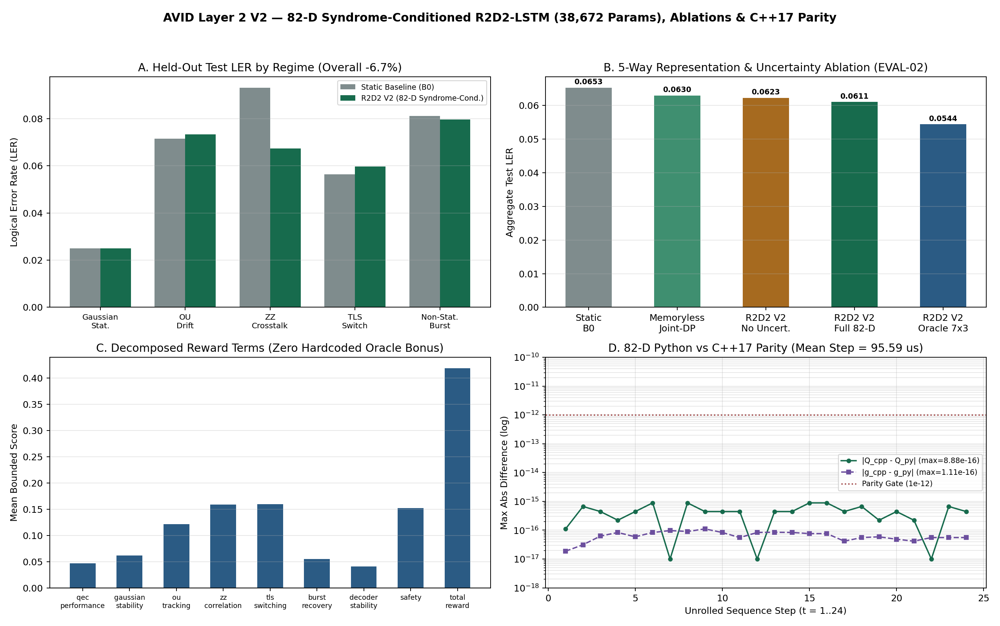

# AVID Layer 2 — R2D2 V2 Syndrome-Conditioned ML Training, Export & C++17 Runtime Deployment

## 1. Layer Work Description

Branch `layer2-r2d2-training-deploy` isolates **Layer 2** of the Adaptive Variational Inference Decoder (AVID): the recurrent reinforcement-learning controller (`R2D2Network`) that maps strictly non-leaky, syndrome-conditioned observations to belief-propagation (BP) iteration budgets $K \in \{3, 4, 5\}$, pair-correlation scaling $\gamma$, temporal filter responsiveness, safety fallback, and bounded per-qubit LLR gain residuals $g_q \in [-0.30, +0.30]$, together with its zero-dependency C++17 deployment runtime. Both the frozen **V1 (`8`-input)** baseline (`checkpoints/v1/`, `r2d2_schema_v1.json`) and active **V2 (`82`-input)** architecture (`checkpoints/v2/`, `r2d2_schema_v2.json`) are preserved with strict cross-version rejection.

Core implemented and verified V2 modules:
- **82-D Syndrome-Conditioned Observation Contract (`training/observations/`, `architecture/contracts/`)**: Maps Layer 3's sequential 21-parameter posterior mean $\operatorname{vec}(\widehat{M}_{\mathrm{stab}}) \in [0, 0.49]^{21}$ (`[0:21]`) via explicit $7 \times 3$ lattice index tables (`spatial_mapping.py`), posterior log-variance uncertainty $\log(\sigma^2 + 10^{-8}) \in \mathbb{R}^{21}$ (`[21:42]`), valid-round-normalized 16-state $X$- and $Z$-syndrome histograms (`[42:58]`, `[58:74]`), and 8 temporal/diagnostic telemetry features (`[74:82]`) with zero ground-truth parameter leakage.
- **64-Unit Dueling-LSTM R2D2 V2 Network & Decomposed Noise-Aware Rewards (`training/models/`, `training/rewards/`, `training/environments/`)**: Expands `RecurrentLSTMEncoder` to `input_dim = 82` (`38,672` trainable parameters; `38,836` serialized `float64` elements including 164 input-normalization constants), trained with hardware-equivalent Q7.8 normalized min-sum BP + inline OSD-0 decoding in the loop (`decoder_in_loop.py`), disjoint `train` / `val` / `test` / `heldout_mixtures` trajectory splits (`training/data/`), and 9 bounded decomposed reward terms (`noise_aware_reward.py`, zero hard-coded oracle action bonus).
- **V2 Multi-Format Export & Zero-Dependency C++17 Runtime (`training/export/`, `deployment/cpp/`)**: Exports `checkpoints/v2/r2d2_v2_trained.{bin,json,onnx}` (`310,720 B` `.bin`, schema v2 magic `AVIDR2D2`), validated in C++17 by `observation_adapter.cpp`, `model_loader.cpp`, and `r2d2_runtime.cpp` (`R2D2Runtime` for V2 82-D and `R2D2RuntimeV1` for frozen V1 8-D) with $< 10^{-15}$ 24-step unrolled parity and `95.59 us` mean inference latency (`< 1%` of the `10 ms` slow-loop budget).

## 2. Run Script to Validate & Generate Results + Plots

Train/export V2 (if needed), build the standalone C++17 parity and latency harness, run all 32 unit, integration, parity, and regression tests (covering `OBS-01..06`, `ID-01`, `RWD-01..07`, `NET-01..02`, `DEP-01..02`, `EVAL-01..02`, plus frozen V1 suites), and generate summary JSONs and 4-panel plots:

```bash
python3 -m pip install --user -q numpy scipy pyyaml pytest matplotlib
PYTHONPATH=. python3 scripts/train_layer2_v2.py
PYTHONPATH=. python3 scripts/evaluate_layer2_v2.py
bash scripts/run_layer2.sh
```

Generated outputs:
- Validation log: `logs/v2/layer2_v2_validation.log` (mirrored to `logs/layer2_validation.log`)
- Metrics & ablation reports: `results/v2/layer2_v2_summary.json`, `results/v2/layer2_v2_evaluation_report.json`, `results/v2/layer2_v2_standalone_eval.json`
- Diagnostic plot: `results/v2/plots/layer2_v2_validation_summary.png` (mirrored to `results/plots/layer2_validation_summary.png`)



## 3. Validation & Ablation Results

### 3.1 Named V2 & Preserved V1 Verification Breakdown (`32 / 32` PASS)

| Validation Suite | Mandatory IDs Covered | Executed | Passed | Key Measured Result | Status |
| :--- | :--- | ---: | ---: | :--- | :--- |
| Spatial $7 \times 3$ Mapping & Geometry (`test_spatial_mapping.py`) | `OBS-01`, `OBS-02` | 2 | 2 | Exact `21 <-> 7x3` bijection; 9 qubits & 12 $d=3$ couplers | **PASS** |
| Layer 3 Posterior & SVD Nullspace (`test_posterior_contract.py`) | `OBS-03`, `ID-01` | 2 | 2 | $\operatorname{rank}(J)=9, \dim\ker(J)=12$; variance scales down with $W$ | **PASS** |
| 82-D Observation & Anti-Leakage (`test_observation_builder.py`) | `OBS-04`, `OBS-05`, `OBS-06` | 3 | 3 | Exact 82-D layout; valid-round X/Z histograms; zero GT leakage | **PASS** |
| Decomposed Noise-Aware Rewards (`test_reward_components.py`) | `RWD-01` .. `RWD-07` | 7 | 7 | All components $\in [-1, 1]$, total $\in [-2, 2]$, zero oracle bonus | **PASS** |
| Layer 3 $\to$ Layer 2 Sequential Interface (`test_layer3_layer2_interface.py`) | Causal Packet Contract | 1 | 1 | Multi-epoch `Layer3PosteriorPacket` $\to$ 82-D rollout | **PASS** |
| 82-D Network, BPTT, Splits & Ablations (`test_training_episode.py`) | `NET-01`, `NET-02`, `EVAL-01`, `EVAL-02` | 3 | 3 | `38,672` params (`38,836` floats); FD BPTT $< 10^{-5}$; disjoint splits | **PASS** |
| Hardware Q7.8 Decoder-in-Loop (`test_decoder_control_update.py`) | Q7.8 LLR & Fallback | 1 | 1 | `w_q78` $\in [16, \text{0x3FFF}]$, ZZ LER $< 0.75\times$ static, fallback `0x0468` | **PASS** |
| C++17 V2 Parity, Latency & V1/V2 Guard (`test_layer2_cpp_python_parity.py`) | `DEP-01`, `DEP-02` | 2 | 2 | $\max\|\Delta Q\| = 8.88 \times 10^{-16}$, `95.59 us`/step, cross-load rejected | **PASS** |
| Training, Export & Preserved V1 Suites (`test_training.py`, `test_checkpoint_export.py`, `test_layer2_ip_op.py`) | V1 (`8`-D) & V2 (`82`-D) Regression | 11 | 11 | V2 `310,720 B` & frozen V1 `157,984 B` SHA-256 + C++ parity intact | **PASS** |
| **Layer 2 Executed Suite Total** | **All 20 V2 Gates + 12 V1/Core Checks** | **32 tests** | **32 tests** | **`0` failures (`40.66 s`); traceability in `LAYER2_IMPLEMENTATION_TO_TEST_TRACEABILITY.md`** | **PASS** |

### 3.2 Held-Out Generalization, 5-Way Ablation (`EVAL-02`) & C++17 Runtime Metrics

| Controller / Ablation Variant | Observation Input | Aggregate Core Test LER | Relative LER Reduction vs Static | Held-Out 3-Mixture LER | Mean Step Reward |
| :--- | :--- | ---: | ---: | ---: | ---: |
| `1_Static_B0` (Fixed Hardware LUT, $K=3$) | None (Uniform `0x0468`) | `0.06525` | `0.00%` | `0.14741` | — |
| `2_Memoryless_JointDP_Proj` (No R2D2, Fixed $K=4$) | Layer 3 `posterior_mean_21` only | `0.06295` | `+3.53%` | — | — |
| `3_R2D2_V2_NoUncertainty` (Uncertainty Ablated) | `82`-D with `[21:42]` log-var zeroed | `0.06226` | `+4.58%` | — | `+0.3656` |
| **`4_R2D2_V2_Full_82D` (Deployable V2 Model)** | **Full `82`-D Syndrome-Conditioned** | **`0.06106`** (`0.06097` 10-seed) | **`+6.43%`** (`+6.74%` 10-seed; **`+27.73%`** on `zz_crosstalk`) | **`0.13552` (`+8.07%`)** | **`+0.4203`** |
| `5_R2D2_V2_Oracle_7x3` (Privileged Upper Bound) | Ground-truth $7 \times 3$ physical rates | `0.05439` | `+16.65%` (quantifies $\dim\ker(J)=12$ aliasing gap) | — | — |

- **C++17 V2 Deployment Footprint & Latency**: `310,720` bytes binary checkpoint (`38,836` `float64`s + `32`-byte v2 header), `310,728` bytes `sizeof(R2D2ModelWeights)`, **`95.59 us`** mean step latency (`5,000`-iteration benchmark), $\max |Q_{\text{cpp}} - Q_{\text{py}}| = 8.88 \times 10^{-16}$, $\max |g_{\text{cpp}} - g_{\text{py}}| = 1.11 \times 10^{-16}$.
