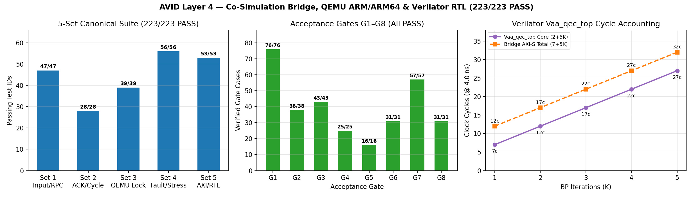

# AVID Layer 4 — Hardware-in-the-Loop Co-Simulation Bridge & Emulators

## 1. Layer Work Description

Branch `layer4-cosim-bridge-emu` isolates **Layer 4** of the Adaptive Variational Inference Decoder (AVID): the deterministic co-simulation boundary connecting embedded ARM/ARM64 HAL software (Layer 3) to the cycle-accurate SystemVerilog FPGA decoder `aa_qec_top` (Layer 5).

Core implemented, remediated (`DEF-L4-01`..`12`), and verified work in this layer:
- **Deterministic Unix-Socket Co-Simulation Bridge (`emulator/bridge/`)**: Single-threaded JSON-over-`AF_UNIX` protocol v1 server handling `RESET`, `MMIO_WRITE`, `MMIO_READ`, and `SYNDROME_TRANSFER` with strict schema/alignment/SLVERR validation, `MSG_NOSIGNAL` fault safety, multi-client reconnect handling, and per-line durable `m3_transactions.jsonl` logging.
- **Native Verilator RTL Integration (`emulator/verilator/`)**: Drives compiled `Vaa_qec_top` (`Verilator 5.048 --assert`) across AXI4-Lite (`0x000..0x144` shadow/active X & Z weight banks, `COMMIT` lock, `CFG_MAX_ITER`, `OSD_MODE`) and AXI4-Stream syndrome/correction channels with exact cycle accounting ($C_{\text{core}}(K) = 2 + 5K$, $C_{\text{axis}}(K) = 7 + 5K$).
- **QEMU ARMv7 Cortex-A9 & ARM64 Cortex-A53 Lockstep (`emulator/qemu/`)**: Cross-compiled 32-bit and 64-bit guest binaries executing deterministic multi-epoch lockstep transactions against `avid_cosim_bridge` + `Vaa_qec_top`. *(Scope note: user-mode QEMU validates ARM32/ARM64 ELF ABI, endianness, Q7.8 packing, and RPC lockstep; post-route Vivado 250 MHz STA belongs to physical FPGA sign-off.)*

## 2. Run Script to Validate & Generate Results + Plots

Compile native Verilator `Vaa_qec_top` + cross-compiled ARM/ARM64 guests, run all 5 canonical test sets (`223` IDs), evaluate gates `G1`–`G8`, and generate plots from the repository root:

```bash
python3 -m pip install --user -q numpy pyyaml pytest matplotlib
bash scripts/run_layer4.sh
```

To regenerate `results/layer4_summary.json` and `results/plots/layer4_validation_summary.png` directly from the committed clean audit run (`remediated_full_layer4_v1`):

```bash
python3 scripts/plot_layer4_results.py
```

Generated outputs:
- Execution log & report: `logs/layer4_validation.log`, `validation/layer4/reports/layer4_validation_report.md`
- Gate manifest & summary: `validation/layer4/runs/remediated_full_layer4_v1/acceptance/gate_evaluation.json`, `results/layer4_summary.json`
- Diagnostic plot: `results/plots/layer4_validation_summary.png`



## 3. Validation Results

| Validation Set / Acceptance Gate | Scope Verified | Cases | Passed | RTL Cycles / Key Metric | Status |
| :--- | :--- | ---: | ---: | :--- | :--- |
| **Set 1** — Input & RPC Contracts | JSON v1 schema, MMIO map, `SYNDROME_TRANSFER`, ordering, socket recovery | 47 | 47 | `75,563` RTL cycles (`1.15 s`) | **PASS** |
| **Set 2** — Output & Cycle Accounting | Cycle-stamped ACKs, latency invariants, RTL parity, deterministic replay | 28 | 28 | `13,342` RTL cycles (`0.23 s`) | **PASS** |
| **Set 3** — QEMU–Verilator Lockstep | E2E HAL flows, ARM Cortex-A9 & ARM64 Cortex-A53 lockstep, epoch & `m3` trace | 39 | 39 | `61,386` RTL cycles (`5.72 s`) | **PASS** |
| **Set 4** — Runtime Stress & Recovery | Bridge startup, burst stress, fault injection, SIGKILL durability, restart | 56 | 56 | `1,262,512` RTL cycles (`44.55 s`) | **PASS** |
| **Set 5** — Hardware Interface & AXI | AXI4-Lite SLVERR, AXI4-Stream backpressure, `wx != wz` bank swap, OSD modes | 53 | 53 | `143,890` RTL cycles (`1.12 s`) | **PASS** |
| **Gates `G1`–`G4`** | Protocol (`76`), Transaction (`38`), Cycle (`43`), Functional Equivalence (`25`) | 182 | 182 | `K=3`: `17` core / `22` AXI cycles (`0` mismatches) | **PASS** |
| **Gates `G5`–`G8`** | Lockstep (`16`), Epoch (`31`), Fault Recovery (`57`), Reproducibility (`31`) | 135 | 135 | Clean git tree (`Dirty=False`), native Verilator | **PASS** |
| **Layer 4 Total** | **Complete 5-Set Canonical Suite & All 8 Gates (`G1`–`G8`)** | **223 IDs** | **223 IDs** | **`1,556,693` native Verilator RTL cycles (`0` failures)** | **PASS** |
