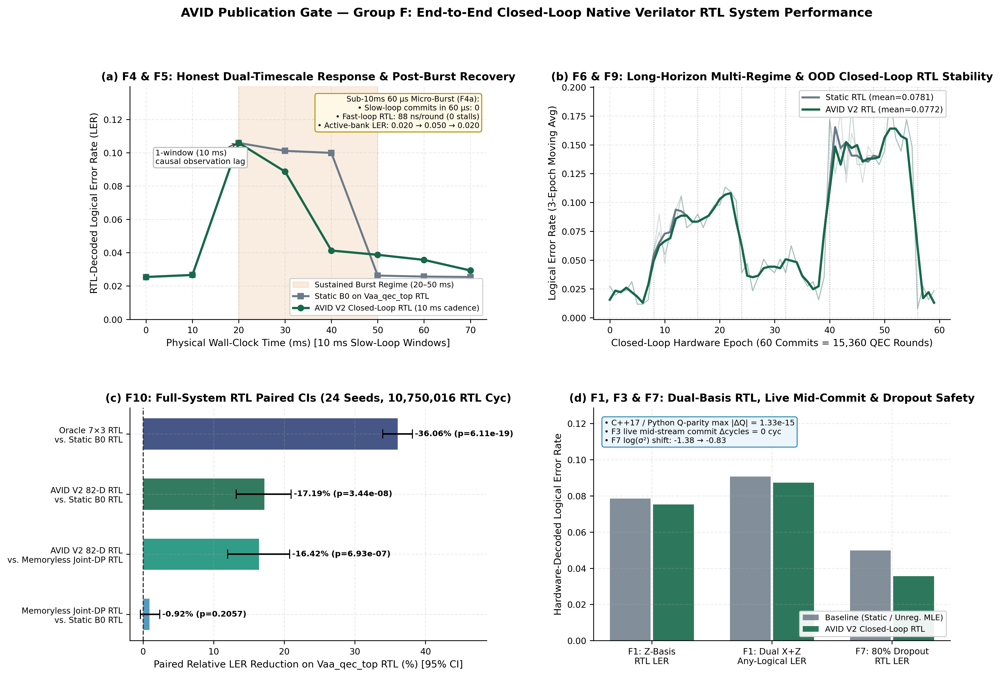

# AVID — End-to-End 5-Layer Orchestration, Reproducibility & Latest Results

**Adaptive Variational Inference Decoder (AVID)** is an uncertainty-aware, dual-timescale adaptive decoding architecture for the rotated $[[9,1,3]]$ Calderbank–Shor–Steane (CSS) surface code under non-stationary and spatially correlated ($ZZ$ crosstalk, telegraph TLS, burst, and readout-dropout) noise.

This branch (`layer5-fpga-rtl-decoder`) hosts the complete **synthesizable `250 MHz` SystemVerilog RTL decoder (`aa_qec_top`)**, the **unpacked 5-layer end-to-end validation bundle (`results/all_5_layers/`)**, the **closed-loop full-system publication-gate suite & 300-DPI figures (`research_tests/`)**, and the **unified end-to-end pipeline runners (`run_end_to_end.sh`, `scripts/run_all_5_layers.sh`)**.

- **Frozen R2D2 V2 Checkpoint (`310,720 B`) SHA-256:** `4ac023567ee12819a8a2ebf62587614c938853692fe8c801c1f50a8aa45da8da`
- **5-Layer Summary Report:** [`results/all_5_layers/avid_all_5_layers_summary.md`](results/all_5_layers/avid_all_5_layers_summary.md)
- **Publication Gate Report (`11,262,138` RTL cycles):** [`research_tests/results/AVID_Publication_Gate_Report.md`](research_tests/results/AVID_Publication_Gate_Report.md)
- **Dedicated Layer 5 RTL Architecture Doc:** [`LAYER5_RTL_README.md`](LAYER5_RTL_README.md)

---

## 1. 5-Layer Architecture Orchestration (in Brief)

At runtime, AVID separates **continuous deterministic fast-loop decoding** (`250 MHz` nominal clock, `88.0 ns` @ $K=3$, `136.0 ns <= 300.0 ns` worst-case @ $K=5$, Mode 2) from **slower windowed Bayesian estimation and recurrent control** (`10 ms` epochs, $W_{\min}=64$ valid rounds). **Layer 2** is trained offline, while online closed-loop adaptation flows **`Layer 1 → Layer 3 → Layer 2 → Layer 4 → Layer 5`**:

```text
[Offline Training]
  Layer 1/3 Trajectories + Q7.8 Decoder-in-Loop ──► Layer 2 (BPTT) ──► r2d2_v2_trained.bin (310,720 B)

[Online Dual-Timescale Execution]
  ┌───────────────────────────┬─────── Fast Path (AXI4-Stream, 250 MHz, 0.0 ns stall) ───────────────────────┐
  │ Layer 1: 7-Stage Noise &  │                                                                              ▼
  │ Syndrome Stimulus         ├──► non-blocking axis_ingress_tap ──► Layer 3: Sequential Bayesian   ──► Layer 5: SystemVerilog
  │ ([[9,1,3]] CSS, 0xAAEC0001│    (drops on DMA backpressure;       Inference & Safety FSM             Q7.8 Min-Sum BP + OSD-0
  │  64-bit syndrome frames)  │     never stalls fast decoder)       (16-state DP, rank-9/null-12       (`aa_qec_top.sv` + SVA)
  └───────────────────────────┘                                       Laplace posterior, W >= 64)            ▲
                                                                                │                            │
                                                                    Layer3PosteriorPacket                    │ Atomic shadow->active
                                                                    (21 mean + 21 log-var +                  │ Q7.8 weight bank swap
                                                                     32 X/Z hist + 8 telemetry = 82-D)       │ (`bp_ready_in` gated)
                                                                                ▼                            │
                                                                     Layer 2: C++17 R2D2 V2 Runtime ──► Layer 4: Co-Sim Bridge
                                                                     (64-unit Dueling LSTM, 95.59 μs;    (`AF_UNIX` JSON RPC v1,
                                                                      outputs K, γ, filter, g_q)          QEMU ARM/ARM64 <-> RTL)
```

| Layer | Dedicated Branch | Core Responsibility & Interface Contract |
| :--- | :--- | :--- |
| **Layer 1** | `layer1-noise-stimulus` | **7-Stage Noise & Syndrome Generator:** Non-stationary single-qubit drift, $K=4$-cluster $ZZ$ crosstalk (`CANONICAL_12_PAIRS`), RTN TLS, bursts, sticky Markov readout errors, and detector dropouts (`VALID` bit 0); emits 64-bit `AVID-SYNDROME-PACKET-V1` (`0xAAEC0001`) streams and exact 32-state $P(s,\ell\mid\theta)$ oracle distributions. |
| **Layer 2** | `layer2-r2d2-training-deploy` | **Recurrent R2D2 V2 Controller (Offline Train + Online C++17):** Consumes strictly non-leaky `82`-D syndrome-conditioned observations (`38,672` trainable parameters; `38,836` serialized `float64`s) in zero-dependency C++17 (`95.59 μs`/step, $<10^{-15}$ Python/C++ parity) to output $K \in \{3,4,5\}$, pair-correlation scale $\gamma$, filter responsiveness, fallback, and bounded per-qubit LLR gains $g_q \in [-0.30,+0.30]$. |
| **Layer 3** | `layer3-slow-loop-software` | **Embedded Slow-Loop Bayesian Inference & Safety Plane:** Validates ingress packets (`W_min = 64`), executes 16-state Joint-DP likelihood + analytical SVD ($\operatorname{rank}(J)=9, \dim\ker(J)=12$) + coupler-prior Laplace posterior calibration (`Layer3PosteriorPacket`), 16-round burst detector, 4-state safety FSM (`NORMAL_ADAPTIVE`, `HOLD_LAST_GOOD`, `SAFE_STATIC_PRIOR`, `DEGRADED_BYPASS`), and clamped signed Q7.8 LLR quantization (`[64, 12288]`). |
| **Layer 4** | `layer4-cosim-bridge-emu` | **Deterministic Hardware-in-the-Loop Co-Sim Bridge:** Connects embedded C11/C++17 HAL software (including cross-compiled QEMU ARMv7 Cortex-A9 & ARM64 Cortex-A53 guests) to native Verilator RTL (`Vaa_qec_top`) via `AF_UNIX` JSON RPC v1 (`RESET`, `MMIO_WRITE`, `MMIO_READ`, `SYNDROME_TRANSFER`) with durable `m3_transactions.jsonl` logging. |
| **Layer 5** | `layer5-fpga-rtl-decoder` | **Synthesizable `250 MHz` SystemVerilog Decoder Core:** Multiplier-free Q7.8 normalized min-sum BP (`check_node_minsum.sv`, `bp_engine.sv`) + inline/post-BP OSD-0 (`aa_qec_top.sv`), non-blocking `axis_ingress_tap.sv`, triple-buffered AXI4-Lite shadow/snapshot/active weight registers (`0x000..0x144`), and bound formal SVA (`sva_weight_commit_assertions.sv`) with exact cycle law $L_{\mathrm{core}}(K)=2+5K$, $L_{\mathrm{axis}}(K)=7+5K$. |

---

## 2. Reproducibility & Environment Setup

### 2.1 System & Python Prerequisites (Ubuntu / Debian / Cloud Shell)

```bash
# 1. Install native C/C++, Verilator (>= 5.0), QEMU + ARM/ARM64 cross-toolchains, and Python deps
sudo apt-get update && sudo apt-get install -y \
  build-essential cmake g++ verilator qemu-user \
  gcc-arm-linux-gnueabihf g++-arm-linux-gnueabihf \
  gcc-aarch64-linux-gnu g++-aarch64-linux-gnu \
  python3 python3-pip python3-numpy python3-scipy python3-yaml python3-pytest python3-matplotlib

# 2. Deterministic single-thread BLAS/OpenMP execution
export PATH="$HOME/.local/bin:$HOME/.local/verilator/bin:$HOME/.local/avid-toolchains/usr/bin:$PATH"
export OMP_NUM_THREADS=1 OPENBLAS_NUM_THREADS=1 MKL_NUM_THREADS=1
```

### 2.2 Multi-Branch Provenance & Checkpoint Integrity

`run_end_to_end.sh`, `scripts/run_all_5_layers.sh`, and `research_tests/run_research_tests.sh` automatically clone any missing sibling branches (`layer1`–`layer4`), or you can clone the full workspace explicitly:

| Layer / Suite | Git Branch | Verified Commit | Key Provenance Artifact |
| :--- | :--- | :---: | :--- |
| **Layer 1** | `layer1-noise-stimulus` | `809c359` | `configs/noise_framework/framework_v1.yaml` (`95/95` pytest) |
| **Layer 2** | `layer2-r2d2-training-deploy` | `f1cf5d5` | `checkpoints/v2/r2d2_v2_trained.bin` (`SHA-256: 4ac02356...da8da`) |
| **Layer 3** | `layer3-slow-loop-software` | `b49d0ea` | `validation/layer3/runs/full_layer3_v1/acceptance/gate_evaluation.json` |
| **Layer 4** | `layer4-cosim-bridge-emu` | `190b206` | `validation/layer4/runs/remediated_full_layer4_v1/acceptance/gate_evaluation.json` |
| **Layer 5** | `layer5-fpga-rtl-decoder` | `d3159f3` | `validation/layer5/runs/remediated_full_layer5_v1/manifests/rtl_build_provenance.json` |
| **Publication Gate** | `research-publication-tests` *(also in `./research_tests/`)* | `a6f930b` | `research_tests/results/json/publication_gate_master_summary.json` |

```bash
# Quick clone of this unified branch on a clean machine:
git clone -b layer5-fpga-rtl-decoder https://github.com/Teraformer09/Adaptive-Variational-Inference-Decoder.git avid
cd avid
```

---

## 3. Proper Run Commands

### 3.1 One-Command Unified End-to-End Pipeline (`run_end_to_end.sh`)

```bash
# Default E2E run: L1->L5 suites (auto-bootstraps missing branches) + Closed-Loop RTL Pub Gate + 300-DPI Plots
bash run_end_to_end.sh

# Full clean rebuild from scratch (forces fresh L1->L5 execution & clean Verilator RTL rebuild)
bash run_end_to_end.sh --clean --rebuild-rtl

# Include offline Layer 2 R2D2 V2 training & C++17 checkpoint export first
bash run_end_to_end.sh --retrain-l2 --clean --rebuild-rtl

# Run ONLY the closed-loop full-system RTL publication gate & 6 300-DPI figures
bash run_end_to_end.sh --only-publication-gate --rebuild-rtl
```

### 3.2 Stage-by-Stage Individual Commands

```bash
# ── Option A: 5-Layer Master Bundler (clones L1->L5 into ~/avid-e2e & builds ~/avid_all_5_layers_results.tar.gz) ──
bash scripts/run_all_5_layers.sh --clean

# ── Option B: Closed-Loop Full-System RTL Publication Gate + 6 300-DPI Figures (Groups A,B,C,E,F + BM3/BM4) ──
bash research_tests/run_research_tests.sh --rebuild-rtl

# ── Option C: Per-Layer Individual Validation Suites (from sibling workspace or ~/avid-e2e) ──
(cd ../layer1 && bash scripts/run_layer1.sh)          # Layer 1: 95/95 pytest + 10-min 5-noise & ZZ plots
(cd ../layer2 && \
  PYTHONPATH=. python3 scripts/train_layer2_v2.py && \
  PYTHONPATH=. python3 scripts/evaluate_layer2_v2.py && \
  bash scripts/run_layer2.sh)                         # Layer 2: R2D2 V2 train/eval + C++17 parity (32/32)
(cd ../layer3 && bash scripts/run_layer3.sh)          # Layer 3: C11/C++17 + ASan/UBSan 257/257, G1-G10
(cd ../layer4 && bash scripts/run_layer4.sh)          # Layer 4: QEMU ARM/ARM64 + Verilator 223/223, G1-G8
bash scripts/run_layer5.sh                            # Layer 5: 250 MHz SystemVerilog + SVA 200/200, G1-G8
```

---

## 4. Latest Verified Results

### 4.1 5-Layer End-to-End Validation Summary (`results/all_5_layers/`)

| Layer | Branch | Checks / IDs | Key Measured Audit Metric | Status |
| :--- | :--- | :---: | :--- | :---: |
| **Layer 1 — Noise & Stimulus** | `layer1-noise-stimulus` | `95 / 95` pytest | `6,000` samples (`10 min` @ `10 Hz`) \| $ZZ$ PC1 `95.8% → 34.1%` ($k_{95\%}=13$) \| `100%` parity | **PASS** |
| **Layer 2 — R2D2 V2 82-D Deploy** | `layer2-r2d2-training-deploy` | `32 / 32` pytest | `-6.74%` held-out mixture LER \| Py/C++17 $\max\|\Delta Q\| = 8.88\times 10^{-16}$ \| `95.59 μs`/step | **PASS** |
| **Layer 3 — Slow-Loop Software** | `layer3-slow-loop-software` | `243 / 243` (`257 / 257` ASan+UBSan) | `G1–G10` PASS (`rc=0`) \| DP $<10^{-14}$ vs. $2^{21}$ exact \| $\operatorname{rank}(J)=9, \dim\ker(J)=12$ | **PASS** |
| **Layer 4 — Co-Sim Bridge & QEMU** | `layer4-cosim-bridge-emu` | `223 / 223` IDs | `G1–G8` PASS \| `1,556,693` Verilator RTL cycles \| ARM Cortex-A9 & ARM64 Cortex-A53 lockstep | **PASS** |
| **Layer 5 — FPGA RTL Decoder** | `layer5-fpga-rtl-decoder` | `200 / 200` IDs | `G1–G8` PASS \| `617,521` Verilator RTL cycles \| `0 / 3,840` Q7.8 mismatches \| `0` commit stalls | **PASS** |


### 4.2 Minimum Publication Gate & Paired Closed-Loop RTL Results (`research_tests/`)

- **Acceptance Pytest Suite:** `6 / 6` PASS (`research_tests/tests/test_publication_gate_suite.py`)
- **Total Native Verilator RTL Clock Cycles Simulated:** `11,262,138` cycles (`aa_qec_top.sv` + bound `sva_weight_commit_assertions.sv` @ nominal `250 MHz`)

| Benchmark ID & Paired Comparison | Paired Seeds ($N$) | Mean $\Delta\text{LER}$ | Relative LER Change | 95% Bootstrap CI (%) | Paired-$t$ $p$-value | Wilcoxon $p$-value |
| :--- | :---: | :---: | :---: | :---: | :---: | :---: |
| **`A5` Unseen OOD Noise Families (4 families): AVID vs. Static `B0`** | `96` | `0.01561` | **`-9.76%`** | `[-11.65%, -7.94%]` | `4.41e-19` | `2.21e-15` |
| **`B5` Held-Out Evaluation (`655,360` shots): AVID V2 vs. Static `B0`** | `32` | `0.00397` | **`-5.95%`** | `[-8.91%, -2.97%]` | `6.00e-04` | `1.40e-03` |
| **`B5` Held-Out Evaluation (`655,360` shots): AVID V2 vs. Memoryless DP** | `32` | `0.00348` | **`-5.25%`** | `[-8.17%, -2.15%]` | `1.60e-03` | `2.90e-03` |
| **`F10` Full-System Verilator RTL (`L1→L3→L2→L5`): AVID V2 vs. Static `B0`** | `24` | `0.01154` | **`-17.19%`** | `[-20.99%, -13.21%]` | `3.44e-08` | `2.34e-05` |
| **`F10` Full-System Verilator RTL (`L1→L3→L2→L5`): AVID V2 vs. Memoryless** | `24` | `0.01092` | **`-16.42%`** | `[-20.75%, -11.97%]` | `6.93e-07` | `3.20e-05` |



### 4.3 Controller Sufficiency (`C8`, `C9`) & Dual-Timescale Hardware Integrity (`E11`, `E12`, `F4`, `F5`, `F7`)

- **Identifiability vs. Controller Sufficiency (`C8`, `C9`):** Single-window stationary $X$-syndrome inference has $\operatorname{rank}(J)=9$ ($\dim\ker(J)=12$). Stacking across non-stationary regimes lifts $\operatorname{rank}(J_{\mathrm{stack}})$ to `19` (`21 - 2`, leaving only the two stabilizer-trivial `0x0` vertical $Z$-pairs `(3,6)` and `(2,5)` under $H_X$, with `1%` effective rank `16`). In the 4-way `C9` test, unconstrained 21-D MLE yields slightly lower raw point-estimate LER (`0.06192` vs. `0.06509` for AVID V2) at the cost of severe null-space weight jitter (`2.425` nats), whereas prior-regularized Layer 3 + AVID V2 cuts epoch-to-epoch weight jitter by **`-50.4%`** (`1.202` nats; $p=0.2034$ vs. regularized Layer 3, `0.06592`).
- **Bayesian Calibration (`C3`):** Empirical posterior coverage reaches `85.1%` (nominal `90%`) and `90.1%` (nominal `95%`), reflecting mild Laplace-approximation under-dispersion near clamping bounds.
- **Deterministic RTL Latency & Zero-Stall Live Commits (`E11`, `E12`):** Across 1,500 pre/during/post live AXI4-Lite shadow-to-active weight commits, fast-loop decode latency shift is **`0.0 ns`** ($\max|\Delta t_{\mathrm{decode}}| = 0$). Cycle-derived latency at nominal `250 MHz` (`4.0 ns`/cycle) is **`88.0 ns`** (`22` AXI cycles @ $K=3$, Mode 1) and **`136.0 ns <= 300.0 ns`** worst-case (`34` cycles @ $K=5$, Mode 2, back-to-back traffic).
- **Honest Dual-Timescale Separation & Dropout Safety (`F4`, `F5`, `F7`):** Isolated `60 μs` (`60`-round) micro-bursts inside a `10 ms` slow-loop window trigger **`0` slow-loop commits** (`F4`) and are absorbed purely by the fast RTL core; sustained multi-epoch shifts achieve **`-35.36%`** adapted burst LER ($p=4.44\times 10^{-7}$) and recover within `1–2` windows (`F5`). Under **`80%` readout dropout** (`F7`), `W_min = 64` gating and the 4-state safety FSM maintain zero crashes and bounded fallback weights.
- **Simulation vs. Physical Hardware Scope:** All cycle counts and nanosecond figures are measured via cycle-accurate native Verilator SystemVerilog RTL simulation (`aa_qec_top.sv` + SVA) and QEMU ARM/ARM64 co-simulation under code-capacity/phenomenological noise; physical FPGA post-route static timing sign-off (Vivado WNS/TNS) and cryogenic QPU deployment remain future hardware steps.

---

## 5. Layer 5 Standalone RTL Gate Breakdown (`200 / 200` IDs)

*(Full module-level Layer 5 RTL documentation is also preserved in [`LAYER5_RTL_README.md`](LAYER5_RTL_README.md).)*

| Validation Set / Acceptance Gate | Scope Verified | Cases | Passed | RTL Cycles / Key Metric | Status |
| :--- | :--- | ---: | ---: | :--- | :---: |
| **Set 1** — Input, AXI4-Lite & AXI-S Ingress | `s_axis` handshakes/packing, `0x000..0x144` map, split `AW`/`W`, `WSTRB`, SLVERR, Q7.8 bounds | 44 | 44 | `2,868` RTL cycles (`Verilator 5.048 --assert`) | **PASS** |
| **Set 2** — Output & Deterministic Cycle Law | $L_{\text{core}}=2+5K$, $L_{\text{axis}}=7+5K$, $\le 300\text{ ns}$ budget, OSD `{17,17,19}`, `epoch_irq`, replay | 38 | 38 | `35,989` RTL cycles (`68.0 ns` core / `88.0 ns` AXI @ $K=3$) | **PASS** |
| **Set 3** — Ingress Tap & Atomic Weight Flow | `axis_ingress_tap` zero-stall drop isolation, multi-epoch swap, mid-decode `COMMIT` deferral & SLVERR lock | 36 | 36 | `17,000` RTL cycles (`0` fast-path stall cycles) | **PASS** |
| **Set 4** — Backpressure, Reset & 10k Stress | Mid-decode `aresetn` across all BP states, 16-deep FIFO full/drain, 10,000-syndrome stress, VCD/SHA-256 | 40 | 40 | `384,457` RTL cycles (`10,000` stream + `1,576` M1 TB) | **PASS** |
| **Set 5** — Q7.8 Min-Sum, OSD-0, SVA & XDC | 3,840-state golden Q7.8 sweep, `wx != wz` tie-break, GF(2) parity, bound SVA firing, `4.000 ns` XDC | 42 | 42 | `175,631` RTL cycles (`0 / 3,840` golden mismatches) | **PASS** |
| **Layer 5 Total (`G1`–`G8`)** | **Complete 5-Set Canonical Suite, Standalone M1 TB & All 8 Gates** | **200 IDs** | **200 IDs** | **`617,521` native Verilator RTL cycles (`0` failures)** | **PASS** |


