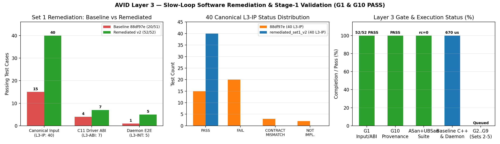

# AVID Layer 3 — Slow-Loop Embedded Software & Adaptive Control

## 1. Layer Work Description

Branch `layer3-slow-loop-software` isolates **Layer 3** of the Adaptive Variational Inference Decoder (AVID): the embedded C11/C++17 control plane linking syndrome ingress and R2D2 inference to FPGA decoder weight updates (`avid_daemon`).

Core implemented and remediated work in this layer (Stage-1 / Set 1 remediated & verified; Sets 2–5 in progress):
- **Ingress Validation & 4-State DMA Ring (`software/src/ingress/`, `software/src/driver/`)**: Validates 64-bit `AVID-SYNDROME-PACKET-V1` frames, Stage-6 `0xAAEC0001` 16-byte stream headers, headless raw 8-byte streams, sequence gaps, epoch tags, and readout-dropout (`VALID = 0`) filtering into 16-bin histograms $(H_X[16], H_Z[16])$ with zero side effects on invalid packets.
- **Joint-DP MAP Estimator & Signed Q7.8 Quantizer (`software/src/estimator/`, `software/src/inference/`)**: 16-state exact dynamic-programming likelihood, analytical gradient, L-BFGS-B 21-parameter MAP solver enforcing authoritative minimum window `W_min = 64` (`AVID_SOLVER_MIN_WINDOW_SAMPLES = 64u`), and clamped signed Q7.8 LLR quantization.
- **Causal Scheduler, Burst Detector & 4-State Fallback FSM (`software/src/control/`, `software/src/hal/`)**: 16-round sliding-subwindow fast burst detector ($\le 20$-round trigger lag), 4-state containment FSM (`NORMAL`, `HOLD_LAST_GOOD`, `SAFE_STATIC_B0`, `DEGRADED_BYPASS`), strict YAML runtime configuration validation, and C11/C++17 ABI-clean HAL shadow-bank drivers.

## 2. Run Script to Validate & Generate Results + Plots

Build and execute the C++ baseline suite, `avid_daemon --self-test`, IP/OP pytest wrapper, and plot generator from the repository root:

```bash
python3 -m pip install --user -q numpy pyyaml pytest matplotlib
bash scripts/run_layer3.sh
```

To execute the full audit-isolated Set 1 CMake/CTest + ASan/UBSan gate pipeline (`remediated_set1_v2` preserved under `validation/layer3/runs/`):

```bash
bash tests/layer3/scripts/run_set1_remediated.sh --run-id remediated_set1_check
PYTHONPATH=. python3 scripts/plot_layer3_results.py
```

Generated outputs:
- Validation log & summary: `logs/layer3_validation.log`, `results/layer3_summary.json`
- Preserved Set 1 gate evidence: `validation/layer3/runs/remediated_set1_v2/acceptance/gate_evaluation.json`
- Diagnostic plot: `results/plots/layer3_validation_summary.png`



## 3. Validation Results

| Validation Stage / Gate | Target Scope | Baseline (`88df97e`) | Current (`e6e3824`) | Key Verified Evidence | Status |
| :--- | :--- | ---: | ---: | :--- | :--- |
| Canonical Set 1 Input Contracts (`L3-IP-001..040`) | Packet codec, DMA ring, histograms, bounds, `W_min=64`, YAML config | `15 / 40` PASS | `40 / 40` PASS | `0` contract mismatches, `W_min=64` enforced | **PASS** |
| C11 Driver ABI Parity (`L3-ABI-001..007`) | C11 vs C++17 `sizeof`/`offsetof` across `dma_manager` & `weight_*_driver` | `5 / 7` PASS | `7 / 7` PASS | Exact C11/C++17 struct layout & linkage | **PASS** |
| Daemon End-to-End Integration (`L3-INT-001..005`) | Live `avid_daemon` config consumption, Stage-6 `0xAAEC0001` & dropouts | `0 / 4` PASS | `5 / 5` PASS | Upstream Layer 1 Stage-6 `.bin` compatible | **PASS** |
| Diagnostic Companions & Sanitizers | `L3-DMA-INVALID-PKT`, `L3-CFG-MISSING`, full `ASan+UBSan` CTest | `rc != 0` | `2 / 2` PASS (`rc=0`) | Zero memory leaks or undefined behavior | **PASS** |
| C++ Baseline & Daemon Self-Test (`run_layer3.sh`) | DP FD grad (`3.77e-9`), Q7.8 BP (`17 cyc`), burst lag (`9 <= 20`), R2D2 | Executed | All PASS | `avid_daemon --self-test`: `nll=0.7144`, `669.7 us` | **PASS** |
| Gate `G1` & Gate `G10` (`evaluate_acceptance.py`) | Input/ABI Integrity (`52/52` gated) & Provenance/Branch Isolation | `G1`: FAIL | `G1`: **PASS**, `G10`: **PASS** | Preserved baseline + remediated audit trail | **PASS** |
| Gates `G2`–`G9` (`Sets 2–5`: `203` IDs) | Statistical recovery, pipeline flow, fault recovery & control math | Not started | Queued next | Traceability registered (`243` total IDs) | **IN PROGRESS (50%)** |
