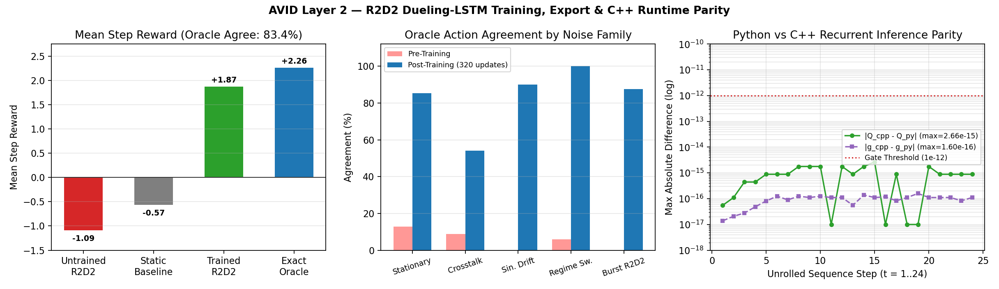

# AVID Layer 2 — R2D2 ML Training, Export & C++ Runtime Deployment

## 1. Layer Work Description

Branch `layer2-r2d2-training-deploy` isolates **Layer 2** of the Adaptive Variational Inference Decoder (AVID): the recurrent reinforcement-learning controller that maps windowed syndrome/noise telemetry to belief-propagation (BP) iteration budgets, pair-correlation scaling, and per-qubit LLR gain residuals, together with its zero-dependency C++17 inference runtime.

Core implemented and verified work in this layer:
- **64-Unit Dueling-LSTM R2D2 Network (`training/`)**: Consumes 8-feature QEC observation vectors $\text{obs}_t \in \mathbb{R}^8$ and recurrent state $(h_t, c_t) \in \mathbb{R}^{64} \times \mathbb{R}^{64}$, trained via prioritized sequence replay, Kapturowski invertible value rescaling, BPTT analytical gradients, and target-network synchronization across 320 updates.
- **Multi-Format Checkpoint Export (`checkpoints/`)**: Deterministic export and schema/CRC validation across `r2d2_v1_trained.bin` (`157,984 B`, `19,744` `float64` parameters, magic `AVIDR2D2`), `r2d2_v1_trained.json`, and `r2d2_v1_trained.onnx`, including corrupted-header/payload rejection.
- **Standalone C++17 Inference & Parity Harness (`deployment/cpp/`, `tests/cpp_layer2_parity_runner.cpp`)**: Pure C++17 `model_loader.cpp` and `r2d2_runtime.cpp` producing `action_id` $\in \{0..5\}$, `bp_iterations` $K \in \{3,4,5\}$, `pair_weight_scale` $\gamma$, `q_values[6]`, and bounded `qubit_gains[9]` $\in [-0.30, +0.30]$ with $< 10^{-12}$ unrolled numerical parity against Python.

## 2. Run Script to Validate & Generate Results + Plots

Build the standalone C++17 runtime harness, run all training/export/parity tests, export `results/layer2_summary.json`, and generate the multi-panel validation plots from the repository root:

```bash
python3 -m pip install --user -q numpy scipy pyyaml pytest matplotlib
bash scripts/run_layer2.sh
```

To regenerate the summary JSON and plots independently:

```bash
PYTHONPATH=. python3 scripts/plot_layer2_results.py
```

Generated outputs:
- Validation log: `logs/layer2_validation.log`
- Metrics JSON: `results/layer2_summary.json`
- Diagnostic plot: `results/plots/layer2_validation_summary.png`



## 3. Validation Results

| Validation Suite / Metric | Target Scope | Executed | Passed | Key Measured Result | Status |
| :--- | :--- | ---: | ---: | :--- | :--- |
| Value Rescaling & BPTT Gradients (`test_training.py`) | Kapturowski bijection, LSTM BPTT & Dueling Q finite-diff | 3 | 3 | Exact analytical-vs-FD gradient parity | **PASS** |
| Sequence Replay & Policy Convergence (`test_training.py`) | Prioritized replay, target sync, 320-update convergence | 2 | 2 | Loss `0.5658 -> 0.0292`; reward `-1.092 -> +1.873` (static `-0.568`) | **PASS** |
| Checkpoint Export & Corruption Guard (`test_checkpoint_export.py`) | `.bin` / `.json` / `.onnx` schema, round-trip & corrupt reject | 3 | 3 | `157,984 B` (`19,744` `fp64` elements) exact reload | **PASS** |
| Python-to-C++17 Recurrent Parity (`test_layer2_ip_op.py`) | 24 unrolled steps across all 6 QEC noise regimes | 1 | 1 | $\max \|Q_{\text{cpp}} - Q_{\text{py}}\| = 2.66 \times 10^{-15} < 10^{-12}$ | **PASS** |
| Per-Qubit Residual Bounds & Action Coverage | `qubit_gains[9]` clip & discrete action diversity (`1,200` steps) | 1,200 steps | 1,200 steps | $\max \|g_{\text{cpp}} - g_{\text{py}}\| = 1.60 \times 10^{-16}$; `6/6` actions (`83.4%` oracle agree) | **PASS** |
| **Layer 2 Executed Suite Total** | **Training + Export + Standalone C++17 Parity** | **9 tests** | **9 tests** | **`0` failures (`1.04 s`); 231-ID traceability mapped** | **PASS** |
