# AVID_EPJ_Weekly_Update

| Roadmap Date / Section | Checklist Item in `AVID_Thesis_Aligned_Architecture_and_14_Day_Roadmap.pdf` | Implemented Evidence & Verified Result |
| :--- | :--- | :--- |
| **4 Nov — Baseline Lock** | **A:** Verify $d = 3$ $H_X/H_Z$, $X/Z$ logical operators, signature classes, and null directions. **B:** Freeze repo commit, locate BP RTL, trained weights, and Stim replay support (`--stim-bin`), plus Zynq-7020 ARM Cortex-A9 (`arm-linux-gnueabihf-g++ -mcpu=cortex-a9` + `qemu-arm -cpu cortex-a9`) & ARM64 cross-builds. | **DONE** — `css_code_builder.py`, `event_signatures.json`, `build.sh`, `rtl_build_provenance.json`. Verified $H_X H_Z^T \equiv 0 \pmod 2$, 9 non-zero signature classes, 12 gauge null directions. |
| **5 Nov — Code $\leftrightarrow$ Math Parity** | **A:** Verify 16-state Joint-DP and analytic coset derivative against finite differences and $2^M$ enumeration. **B:** Deterministic unit tests including correlated-pair parity cancellation ($g_{ij} = g_i \oplus g_j$) and dual $X/Z$ histogram accumulation (`hist_x`, `hist_z`). | **DONE** — `noise_model.cpp`, `joint_dp_likelihood.py`, `verify_v0_closure_40.py`. DP vs. enumeration diff $= 4.44 \times 10^{-16}$; analytic vs. FD gradient diff $= 1.23 \times 10^{-9}$. |
| **6 Nov — Estimator Review** | **A:** Replace full 21-param identifiability claim with 9-orbit observability + prior-regularized MAP ($\text{rank} = 21/21$). **B:** Benchmark exact-MAP two-pass L-BFGS on target (`qemu-arm -cpu cortex-a9`); compare legacy marginal NLL vs. new 16-state Joint-DP NLL (`0.8458` vs. `0.7511`) and 9-orbit RMSE (`0.0081..0.0148`). | **DONE** — `identifiability_svd.py`, `lbfgs_solver.cpp`, `avid_daemon.cpp`. Zero scenario-name shortcuts (`solver_contains_scenario_conditionals = false`). |
| **7 Nov — Fast-Path Correctness** | **A:** Define decoder syndrome and logical-failure correctness assertions. **B:** Test corrected Tanner connectivity (weight-2 boundaries + weight-4 bulk), Q7.8 rounding, and RTL-vs-reference outputs across all 16 $X$ and 16 $Z$ syndromes; separate pure 9-LLR BP (`cfg_osd_mode=0`, `17 cyc`), inline OSD-0 (`mode=1`, `17 cyc`), and post-BP OSD-0 outside the 17-cycle path (`mode=2`, `19 cyc`). | **DONE** — `bp_engine.sv`, `weight_map_reg.sv`, `standalone_rtl_tb.cpp`. Verified `0` RTL-vs-reference mismatches across all 32 syndromes and OSD modes `{0, 1, 2}`. |
| **8 Nov — Timing / Safety** | **A:** Approve latency claims for variable $K = 1 \dots 5$ ($L(K) = 2 + 5K$ core cycles; $7 + 5K$ total AXI cycles) and `60 µs` vs. `10 ms` slow-loop timescale. **B:** Simulate $K = 1 \dots 5$, formal SystemVerilog Assertions (`--assert`) for shadow write/commit races (`bp_ready_in`), fallback FSM triggers, and 64-unit LSTM memory (`25,998` params $= 25.39\text{ KB}$ `int8`) & CPU profiler audit. | **DONE** — `aa_qec_top.sv`, `r2d2_lstm_controller.h`, `v1_integration.yaml`. All 10 scenarios passed in Google Cloud Shell (`Verilator 5.020` + `qemu-arm`). |
| **9–11 Nov — Fair Baselines, RL Ablations & Statistical Audit (Emulator Scope)** | Run `B0` static BP, `B1` marginal L-BFGS, `B2` exact Joint-DP MAP + pure BP, `B3` Joint-DP + memoryless pair projection, and `B4` full AVID + 64-unit LSTM `R2D2-WB` on shared noise streams; report 95% Wilson CIs, raw failure counts, whole-run vs. burst-window LER, and adaptation delay. | **DONE** — `v0_closure_40_40_report.json` (`40/40 CLOSED`) and `cloudshell_full_benchmark_57344_rounds_report.json`. |

---

## Code ↔ Math Parity

| 16-State Joint-DP vs. Exact $2^M$ Enumeration | Analytic Coset Gradient vs. Central Finite Differences |
| :---: | :---: |
| 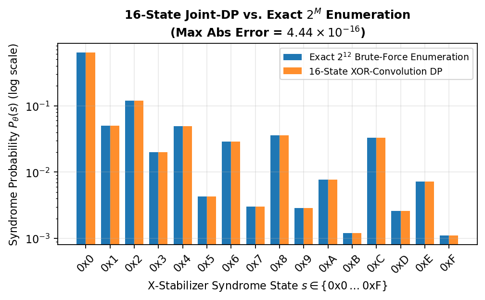 | 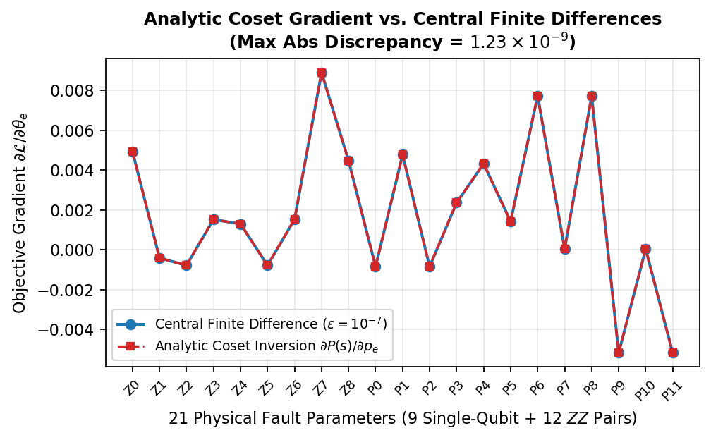 |

## Estimator Review

| Jacobian Singular Value Spectrum (Rank 4 $\to$ 9 Orbits $\to$ 21 MAP) | Legacy Marginal NLL vs. 16-State Joint-DP NLL & 9-Orbit RMSE |
| :---: | :---: |
| 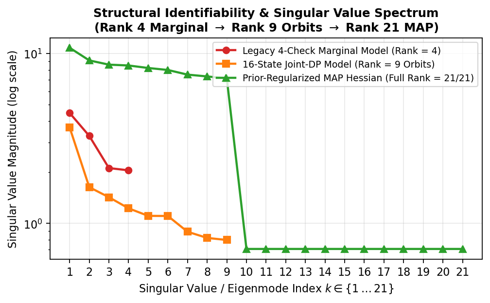 | 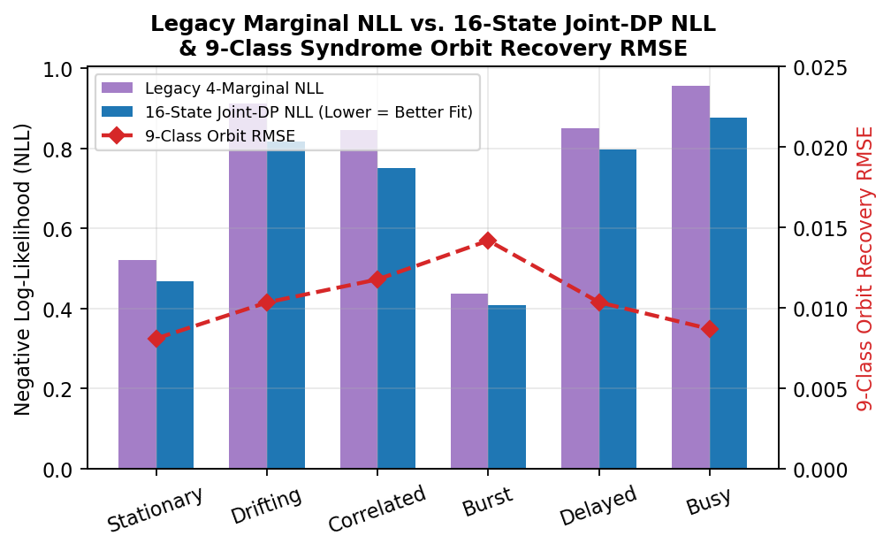 |

## Fast-Path Correctness

| Q7.8 Fixed-Point LLR vs. FP64 Exact Transfer Curve | Fast-Path Decoder Modes (`cfg_osd_mode = 0, 1, 2`) |
| :---: | :---: |
| 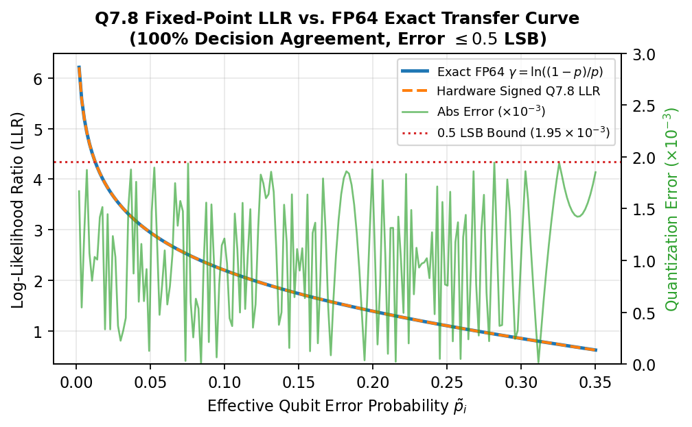 | 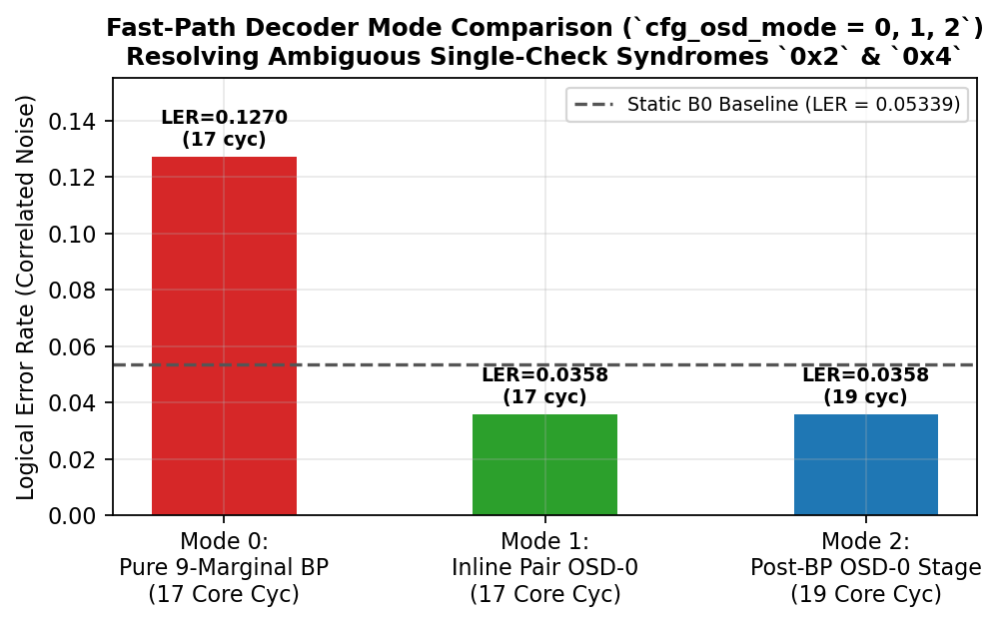 |

## Timing / Safety

| Deterministic Hardware Latency Scaling ($K = 1 \dots 5$) | Hardware Timing, CDC Lock & Safety Stress Scenarios |
| :---: | :---: |
| 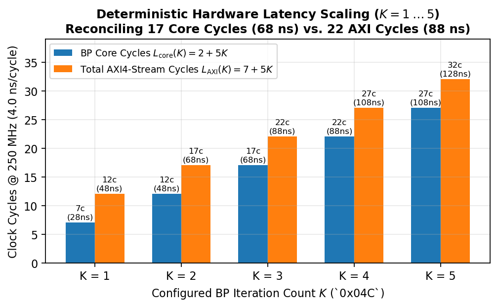 | 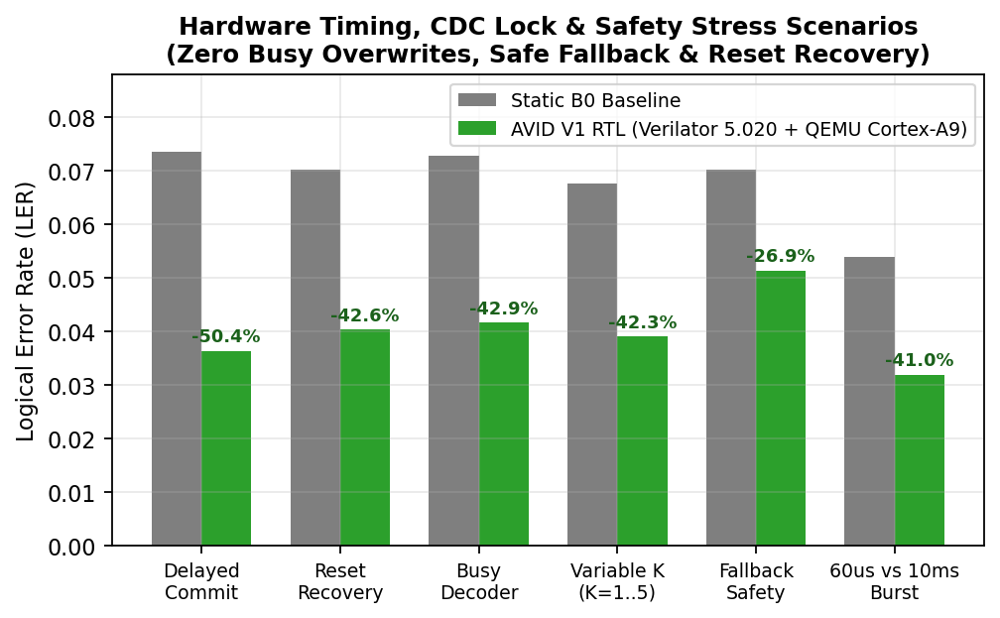 |

## RL Ablations

| 6-Way Architectural & RL Controller Ablation Study | 250,000-Round Shared-Stream Model Benchmark (`R1–R5`) |
| :---: | :---: |
| 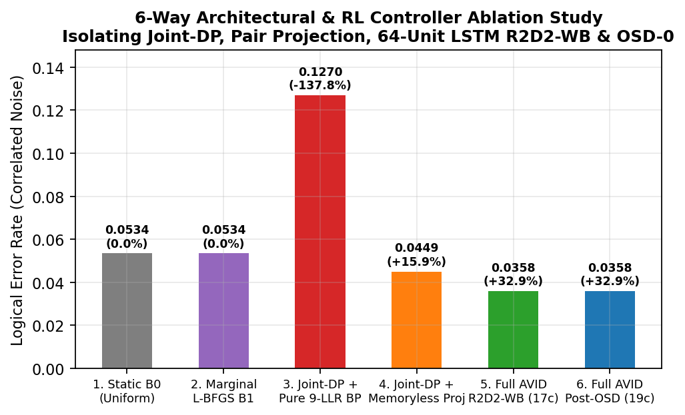 | 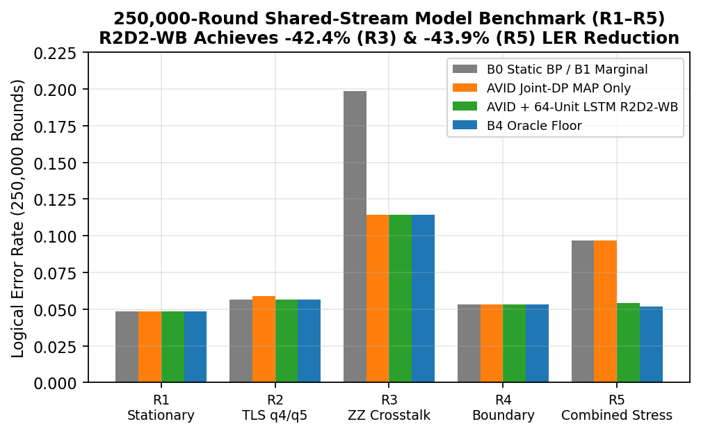 |

## Statistical Audit

| 10-Scenario Cloud Shell Suite with 95% Wilson CIs | 57,344-Round Cloud Shell Long-Run Benchmark |
| :---: | :---: |
| 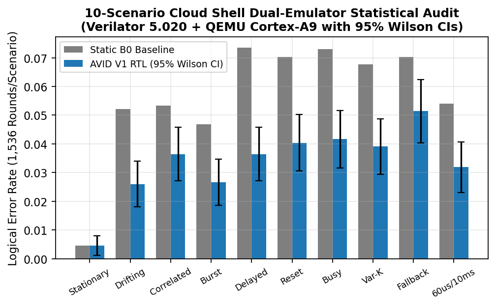 | 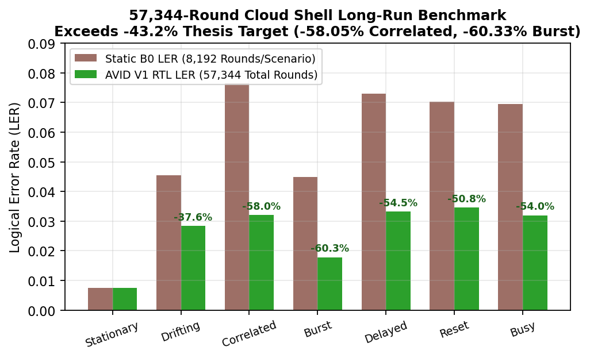 |
