# Layer 3 Input Architecture & Boundary Map (`88df97e`)

## 1. Scope & Control Baseline
- **Branch**: `layer3-slow-loop-software`
- **Verified Production Baseline Commit**: `88df97e86b579b6e2865cc70dc4d0b08225d677b`
- **Production Modification Policy**: **Zero edits** to `software/`, `architecture/`, `deployment/`, `configs/`, or `checkpoints/`.

## 2. Production Input Entrypoints Mapped in Set 1

```mermaid
flowchart LR
    STIM["--stim-bin file / Deterministic Sim"] --> DAEMON["avid_daemon.cpp::main"]
    DAEMON -->|"avid_unpack_packet_u64 (no validate!) + repack VALID"| DMAPUSH["avid_dma_ring_push_burst"]
    DMAPUSH --> DMACONS["avid_dma_ring_consume_slot"]
    DMACONS -->|"avid_validate_packet"| HIST["hist_x[16], hist_z[16]"]
    HIST --> SOLVER["HistogramLBFGSSolver::fit_histogram"]
    SOLVER --> NM["NoiseModel (21 params, 16-state Joint DP)"]
    HIST --> R2D2["R2D2Runtime::step_causal"]
    NM --> Q78["avid_quantize_and_validate_bank / to_pair_projected_q7_8_llr"]
    Q78 --> FSM["avid_fallback_step"]
    FSM --> HAL["avid_hal_write_weights_and_commit -> wrd_*"]
    RING["ring_buffer.h (RING_WINDOW=10000)"] -. "IMPLEMENTED_BUT_UNUSED in avid_daemon" .-> NM
    SCHED["causal_scheduler.h (commit_delay)"] -. "DISCONNECTED from avid_daemon" .-> HAL
```

## 3. Component-by-Component Input Surface Inventory

| Subsystem | Header / Implementation | Primary Input Types | Validation Present at `88df97e` | Missing / Bypassed Checks Discovered |
| :--- | :--- | :--- | :--- | :--- |
| **Packet Ingress** | `software/src/ingress/packet_validator.{h,cpp}` | `uint64_t raw_word`, `avid_packet_validator_t*`, `avid_syndrome_packet_t*` | `VALID==1`, `PARITY_ERR==0`, `seq_id == last_seq_id + 1` (with `UINT32_MAX -> 0` wrap) | No byte-length API; no stream magic/version header; reserved flags `[7:4]` ignored; `s_x,s_z >= 16` silently masked (`& 0x0F`); `*out` & `last_seq_id` mutated on sequence error; `NULL` pointers crash (`SIGSEGV`) |
| **DMA Slot Tap** | `software/src/ingress/dma_ingress_tap.{h,cpp}` | `avid_dma_ring_t*`, `const uint64_t *pkts`, `uint32_t n_pkts`, `uint32_t hist_x[16]`, `hist_z[16]` | 4-slot ring (`FREE -> DMA_OWNED -> CPU_READY -> CPU_OWNED -> FREE`), full-ring drop counter (`overflow_drops`), per-packet `avid_validate_packet` | `n_pkts > 64` silently truncated to 64 with 0 drops counted; `hist_x[s]++` wraps `uint32_t` at `2^32`; no mutex/atomic memory fences (`int` indices); missing `extern "C"` linkage |
| **Syndrome History Ring** | `software/src/inference/ring_buffer.h` | `ring_buffer_t*`, `syndrome_round_t*` (`RING_WINDOW=10000`) | Fixed-capacity circular overwrite (`head`, `count` capped at `10000`) | **`IMPLEMENTED_BUT_UNUSED` in `avid_daemon.cpp`**: daemon never instantiates `ring_buffer_t`, using `uint32_t hist_x[16], hist_z[16]` directly |
| **21-Param Noise Model** | `software/src/inference/noise_model.{h,cpp}` | `ParamVec theta_` (`21`), `prior_theta_` (`21`), `double prior_lambda_`, `const uint32_t hist[16]` | `validate_parameter_bounds` checks `[0, 0.5)` and `std::isfinite`; `clamp_params` clamps `[1e-5, 0.45]`; `total == 0` returns prior tether | `compute_joint_distribution` does **not** call `validate_parameter_bounds` (`std::clamp(NaN)` propagates `NaN`!); public `prior_theta_` and `prior_lambda_` unvalidated; `hist == nullptr` crashes (`SIGSEGV`); default pair prior drifts (`0.003` vs `0.004` vs `0.008`) |
| **L-BFGS Solver** | `software/src/estimator/lbfgs_solver.{h,cpp}` | `NoiseModel&`, `const uint32_t hist[16]`, `int max_iters` | `total == 0` returns early (`converged=false, iters=0`); calls `opt_.reset()` per pass | Hardcodes `model.prior_lambda_ = 0.04` (overwriting caller/schema); `std::max(6, ...)` executes up to `12` iterations when `max_iters <= 1`; no `W_min` sparse-window guard (`N=3` swings $\theta_4 > 0.30$); `NaN` initial guess propagates `NaN` |
| **Q7.8 Quantizer** | `software/src/estimator/llr_quantizer.{h,cpp}` | `const double p_eff[9]`, `int16_t out_q78[9]` | Rejects `!isfinite`, `<=0`, `>=0.5`, and outside `[0x0040, 0x3000]` | `NULL` `p_eff` or `out_q78` crashes (`SIGSEGV`); `AVID_Q78_DEFAULT` (`0x0468=1128`) is 1 LSB off `avid_prob_to_q78_llr(0.012)` (`0x0469=1129`) |
| **Scheduler & Burst Detector** | `software/src/control/causal_scheduler.{h,cpp}` | `fast_window`, `slow_window`, `commit_delay`, `density_threshold`, `debounce_rounds` | `commit_delay` enforced standalone; `threshold <= 0` defaults to `0.35` | `threshold > 1.0` / `+Inf` accepted (disables burst detection forever); older `window_end_round` overwrites newer pending commit; `avid_causal_scheduler_t` **not connected** in `avid_daemon.cpp`; missing `extern "C"` |
| **Safety Fallback FSM** | `software/src/control/fallback_fsm.{h,cpp}` | `avid_fallback_fsm_t*`, 4 `bool` flags, `candidate_q78[9]` | Deterministic 4-state transitions; blocks corrupted candidate weights via `SAFE_STATIC_PRIOR` / `HOLD_LAST_GOOD` | `candidate_q78 == nullptr` or `out_should_commit == nullptr` crashes (`SIGSEGV`); corrupt incoming `state` enum overwritten silently; missing `extern "C"` |
| **HAL, BP Engine, & Drivers** | `hal/avid_hal.h`, `driver/weight_*_driver.c`, `custom_engine/cycle_accurate_bp_engine.cpp` | `avid_hal_t*`, `wrd_handle_t*`, `k_iter`, `osd_mode`, `int16_t weights_q78[9]` | Shadow/active isolation, OOB qubit index returns `0`, `k_iter == 0` rejected in HAL | `avid_hal.h` includes `<cstdint>`/`<cstddef>` outside `#ifdef __cplusplus` (fails C11!); `dma_manager.c` lacks `_POSIX_C_SOURCE` under strict `-std=c11`; `K = 99` accepted without upper bound in BP engine & HAL |
| **Daemon Runtime CLI** | `software/src/inference/avid_daemon.cpp` | `argc/argv` (`--window`, `--rounds`, `--stim-bin`, `--checkpoint`, `--osd-mode`, `--controller-mode`) | Rejects `window<=0`, `rounds<=0`, `osd_mode>2`, `invalid_configuration`, missing checkpoint/stim file (`rc=2`) | Unknown CLI flags (`--unknown-key`), dangling trailing flags (`--window`), and unknown `controller_mode` silently accepted (`rc=0`); no native `configs/schema.yaml` loader; `--stim-bin` bypasses `avid_validate_packet` and re-stamps `AVID_PKT_FLAG_VALID` |
